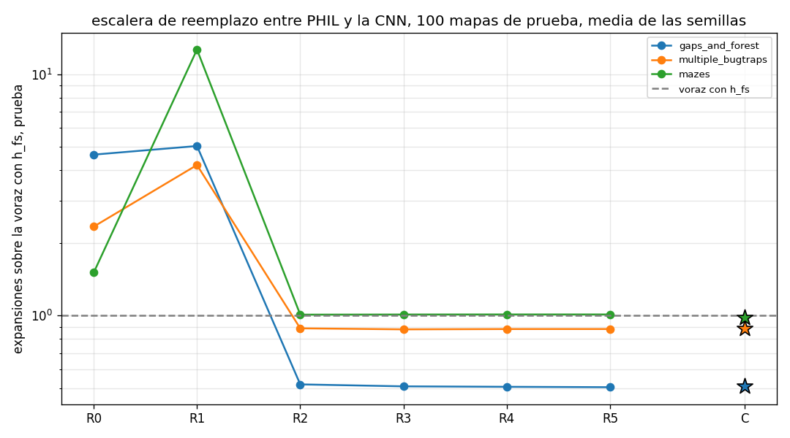
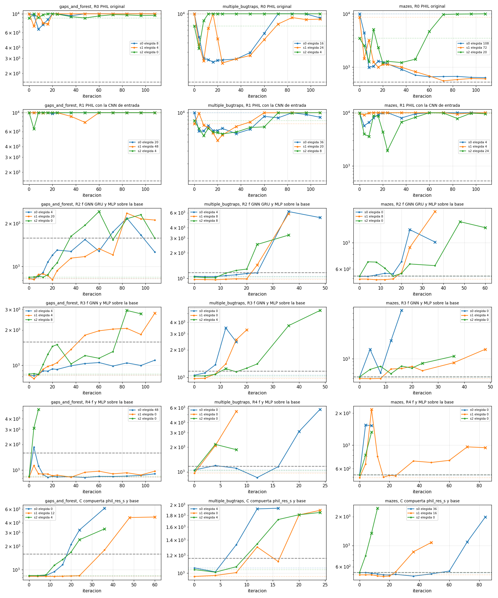
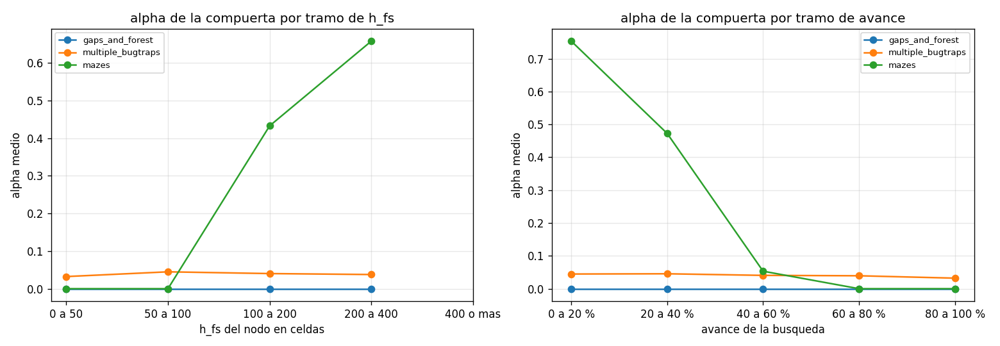
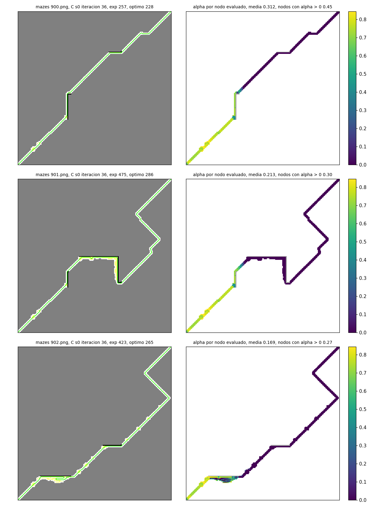
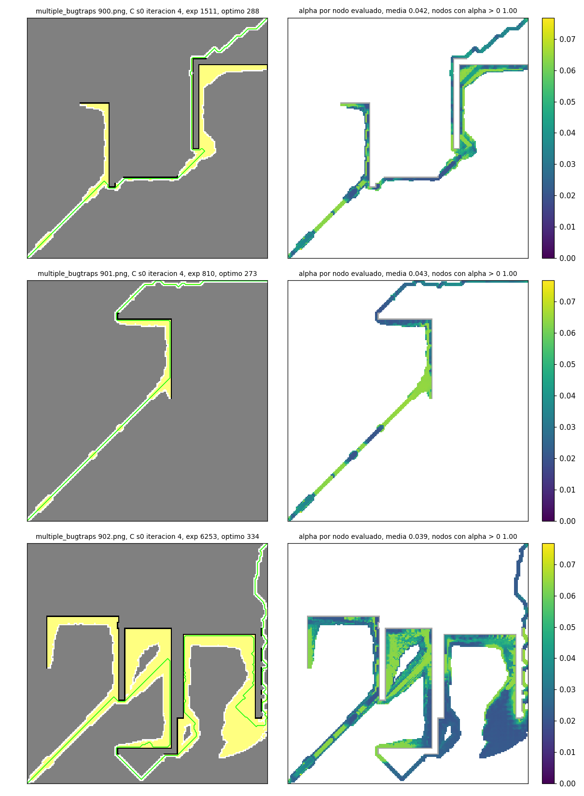
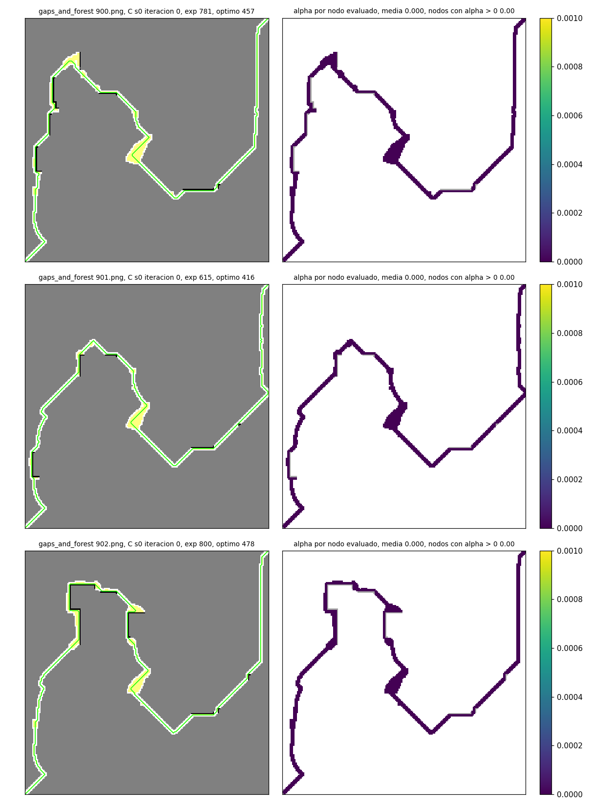

# Resumen de exp_escalera. Corrida completa del 2026-11-05 al 2026-11-06 en Windows con una RTX 4070

Carpeta tesis/code_v4, resultados en results/exp_escalera. Escrito a mano a partir de tablas.md, resumen.csv, escalera.csv, seleccion.csv, los train.csv y config.json de runs, figuras/alpha_stats.csv, figuras/alpha_mapas.csv, los csv de checks y eval, los csv de prueba de cf_filtro y el RESUMEN.md de exp_cf2 en code_v3, maestro.log, trabajos.log, logs/memoria.log y las horas de modificación de epoca_0.pt, listo y los csv de eval para la línea de tiempo. Todo número sale de esos archivos. El borrador automático está en RESUMEN_auto.md.

## En pocas líneas

- La escalera corrió entera. 54 corridas, 6 peldaños por 3 conjuntos por 3 semillas, cada una con su prueba en los 100 mapas, en 823 minutos de reloj desde las 23h06 hasta las 12h50, con 0 fallos y 0 avisos de memoria.
- La CNN reemplaza a PHIL. R3 contra R2, R4 contra R3 y R5 contra R4 pasan en los tres conjuntos. En prueba R2, R3, R4 y R5 quedan entre 0.505 y 0.519 de las expansiones de la voraz con h_fs en gaps_and_forest, entre 0.878 y 0.886 en multiple_bugtraps y entre 1.010 y 1.012 en mazes. Lo que PHIL agrega sobre la base de cf_filtro no se ve en prueba.
- La CNN como entrada de PHIL lo empeora. R1 expande 5.047, 4.21 y 12.665 veces lo de h_fs y R0 expande 4.649, 2.339 y 1.509. R1 contra R0 no pasa en ningún conjunto.
- La CNN como base cambia todo. R2 contra R1 baja 89.7, 79.0 y 92.0 % de las expansiones con p 0.0 y 3 de 3 semillas en los tres conjuntos.
- Lo que la corrección aprendida gana en validación no pasa a prueba. 18 corridas de R2, R3, R4 y C eligieron una iteración aprendida que ganaba a cf_filtro en validación, entre 0.0 y 7.9 %. En prueba 9 quedaron mejor que cf_filtro de su misma semilla, 8 peor y 1 igual a tres decimales.
- La compuerta solo se abre de verdad en mazes. C baja 3.0 % frente a cf_filtro en mazes con p 0.0 y gana en 71 de 100 mapas, pero con 2 de 3 semillas y por debajo del 5 %, así que no pasa. En gaps_and_forest alpha es 0 en todos los nodos y en multiple_bugtraps vale 0.0403 en promedio. En mazes alpha medio es 0.7535 en el primer 20 % de la búsqueda y 0 después del 60 %.
- R1 se llevó más de la mitad del tiempo. Sus 9 corridas sumaron 1618.3 minutos de validación de 2910.8 en total y 487.9 minutos de prueba de 787.9, porque 122 de sus 126 validaciones perdieron mapas y 45 quedaron con la media en el tope de 10 000 expansiones.

## Cómo se corrió

La máquina es la laptop Windows con la RTX 4070 de exp_geo, con el venv de Python 3.14 y torch con CUDA. El maestro experiments/run_escalera.sh se lanzó el 2026-11-05 a las 23h06 con DEVICE=cuda y PARALLEL=5, desacoplado con nohup y con experiments/despierto.py al lado para que la máquina no durmiera. Al lanzar había un juego abierto que usaba 4.4 GB de RAM y la mitad de la GPU, medido antes de lanzar, y por eso el calendario de validación quedó denso al principio y ralo después. El vigía de memoria quedó en logs/memoria.log.

Todos los peldaños entrenan con el protocolo de AggreVaTe de PHIL, T 256, t_tau 32, beta 0.7 elevado a la iteración, 108 iteraciones, lote 32, Adam 1e-3, escala 200 y 8 vecinos.

| peldaño | qué es | parámetros entrenables |
|---|---|---|
| R0 | PHIL original, f, GNN, GRU y MLP, sin base y sin CNN, reentrenado acá | 92483 |
| R1 | PHIL con 43 columnas más de entrada que salen de la U-Net de cf_filtro, b y h_fs sobre la escala, cf, los 32 rasgos del decodificador estandarizados y la diferencia de b con los 8 vecinos, salida directa como en PHIL | 97987 |
| R2 | f, GNN, GRU y MLP corrigiendo la base b de cf_filtro, h igual a max(h_fs, b + tope por tanh de la cabeza), tope 200 celdas, última capa en cero | 97987 |
| R3 | igual que R2 sin la GRU | 73027 |
| R4 | igual que R2 sin la GNN y sin la GRU | 56385 |
| R5 | cf_filtro solo, leído de los csv de prueba de exp_cf2 en code_v3 | 0 |
| C | compuerta alpha entre phil_res_s congelado de exp_cf y la base de cf_filtro, h igual a alpha por h_phil más 1 menos alpha por b, alpha recortado entre 0 y 1 con gradiente derecho y última capa en cero | 29441 |

La U-Net de cf_filtro de la misma semilla va congelada, en CUDA durante el entrenamiento y la validación y en CPU en la prueba, igual que en exp_mem. Entrega la base b igual a h_fs sobre cf con cf cada 20 expansiones y h_fs cada 16, y los 32 rasgos en la misma pasada. Los rasgos se estandarizan con media y desvío por canal calculados sobre 200 fotos base de entrenamiento por conjunto y semilla.

La selección es camino5 en los mapas de validación, 65 en gaps_and_forest y 70 en los otros dos conjuntos, respecto de la voraz con h_fs, con la iteración 0 como candidata. En R2, R3, R4 y C la elegida además tiene que ganar a la iteración 0 de la misma corrida, que es cf_filtro medido acá, y si ninguna gana la corrida queda en cf_filtro con best.pt igual a la iteración 0. Derrumbe es perder mapas o expandir más de 1.5 veces lo de h_fs, con corte al segundo derrumbe seguido sin contar la iteración 0, solo en R2, R3, R4 y C, así que el primer corte posible cae en la iteración 8. R0 y R1 no se cortan y corren las 108 iteraciones, se elige la elegible de menos expansiones y si no hay ninguna la de menos expansiones a secas, marcada como sin elegibles. Tope de 10 000 expansiones.

Lo que se aparta del documento de la escalera y queda anotado.

- Se validó en las iteraciones 0, 4, 8, 12, 16, 20, 24, 36, 48, 60, 72, 84, 96 y 108, 14 validaciones en vez de 28, por el costo medido con el juego abierto.
- R0 y R1 corren sin corte, porque PHIL original arranca muy por encima de h_fs en gaps_and_forest y multiple_bugtraps y el corte los mataría en la tercera validación, la iteración 8.
- En mazes el cf_filtro de la semilla 2 es la época 0 de la Mac, best_epoca 0 en su config.json. Según lo previsto antes de lanzar eso es cf constante 0.5 y base 2 h_fs, que ordena igual que h_fs, con rasgos de una U-Net sin entrenar, y en efecto su iteración 0 vale 523.1 en validación, lo mismo que la voraz con h_fs. Se corrió igual y en las tablas la semilla 2 de mazes vale 1.000 en todos los peldaños con base.
- R0 se reentrenó acá con 3 semillas. Las pruebas viejas de PHIL con 5 semillas de exp_cf y las de phil_res_s de exp_cf van como filas de control.

## Verificaciones previas

Las pruebas test_cf, test_geo y test_escalera pasaron a las 23h11, 4 minutos. Después corrieron 18 verificaciones por conjunto y semilla, 3 a la vez, 25 minutos, y pasaron las 18. El humo con 2 iteraciones y 2 mapas por peldaño en mazes había pasado antes de lanzar.

| verificación | resultado |
|---|---|
| iteración 0 de R2, R3, R4 y C igual a cf_filtro en cada mapa, mismo conjunto de nodos expandidos, mismo resultado y mismo camino, con la U-Net en CUDA de los dos lados | 65 de 65 mapas en gaps_and_forest y 70 de 70 en multiple_bugtraps y mazes, en los 4 brazos y en las 9 parejas de conjunto y semilla |
| fuga, cambiar 200 celdas no vistas del mapa real no cambia las 43 columnas ni la salida de R2 ni la de C | pasa en las 9 parejas |

La iteración 0 medida acá contra la validación de cf_filtro leída del config.json de la Mac, en los mapas de validación, 65 en gaps_and_forest y 70 en los otros dos.

| conjunto | semilla | iteración 0 acá | cf_filtro en la Mac | voraz con h_fs |
|---|---|---|---|---|
| gaps_and_forest | 0 | 822.7 | 822.5 | 1579.2 |
| gaps_and_forest | 1 | 821.4 | 823.2 | 1579.2 |
| gaps_and_forest | 2 | 841.0 | 835.1 | 1579.2 |
| multiple_bugtraps | 0 | 1054.9 | 1072.3 | 1163.4 |
| multiple_bugtraps | 1 | 966.9 | 970.6 | 1163.4 |
| multiple_bugtraps | 2 | 1036.4 | 1032.9 | 1163.4 |
| mazes | 0 | 520.1 | 520.7 | 523.1 |
| mazes | 1 | 493.9 | 493.5 | 523.1 |
| mazes | 2 | 523.1 | 523.1 | 523.1 |

Las 18 corridas de R2, R3, R4 y C que quedaron en cf_filtro se probaron con la U-Net en CPU y se compararon mapa por mapa con los csv de prueba de cf_filtro de exp_cf2. Son iguales en los 100 o 91 mapas en 13 corridas. En las otras 5 difieren en 2 o 3 mapas, gaps_and_forest C semilla 0 en 89 de 91 con media 818.0 contra 817.8, gaps_and_forest R4 semilla 1 en 88 de 91 con media 781.4 contra 781.0, y multiple_bugtraps R3, R4 y C semilla 1 en 98 de 100 con media 971.6 contra 972.2. En los mapas que difieren la diferencia va de 1 a 56 expansiones. Las tres corridas de multiple_bugtraps semilla 1 dan lo mismo entre sí mapa por mapa, así que la diferencia es entre las dos máquinas y no entre corridas. La causa no quedó registrada. Lo más probable es que la U-Net en CPU dé valores apenas distintos en las dos máquinas y eso cambie algún desempate. Las filas de R5 de las tablas salen de los csv de la Mac.

## La escalera en prueba

Prueba en los 100 mapas de cada conjunto, 91 resolubles en gaps_and_forest, tope de 10 000 expansiones, media de las 3 semillas. La relación es expansiones sobre las de la voraz con h_fs.

| conjunto | R0 | R1 | R2 | R3 | R4 | R5 | C | phil_res_s | PHIL viejo, 5 semillas |
|---|---|---|---|---|---|---|---|---|---|
| gaps_and_forest | 4.649 | 5.047 | 0.519 | 0.509 | 0.507 | 0.505 | 0.509 | 0.98 | 4.395 |
| multiple_bugtraps | 2.339 | 4.21 | 0.886 | 0.878 | 0.88 | 0.88 | 0.883 | 0.985 | 1.939 |
| mazes | 1.509 | 12.665 | 1.01 | 1.011 | 1.012 | 1.012 | 0.981 | 0.934 | 1.01 |

Las mismas filas en expansiones, con la voraz con h_fs y la voraz con h* de referencia.

| conjunto | h* | h_fs | R0 | R1 | R2 | R3 | R4 | R5 | C | phil_res_s | PHIL viejo |
|---|---|---|---|---|---|---|---|---|---|---|---|
| gaps_and_forest | 474.0 | 1604.0 | 7456.5 | 8095.2 | 832.7 | 817.2 | 813.6 | 810.5 | 815.9 | 1571.2 | 7049.4 |
| multiple_bugtraps | 268.7 | 1127.3 | 2636.9 | 4745.7 | 998.9 | 989.2 | 992.1 | 992.3 | 995.7 | 1110.5 | 2185.9 |
| mazes | 267.7 | 442.4 | 667.4 | 5603.2 | 446.8 | 447.3 | 447.6 | 447.6 | 434.1 | 413.2 | 446.6 |

Las comparaciones del documento, de escalera.csv. Wilcoxon pareado por mapa sobre la media de las semillas, p con 4 decimales. El criterio baja pide bajar más de 5 % con p menor que 0.05 y 3 de 3 semillas, en 2 de 3 conjuntos. El criterio igual pide no quedar más de 5 % peor en ningún conjunto. En los dos el camino no puede salir más de 5 % peor.

| a | b | conjunto | criterio | expansiones a | expansiones b | a sobre b | mejora % | p | mapas donde gana a | a sobre b por semilla | semillas menores que 1 | camino a sobre b | pasa |
|---|---|---|---|---|---|---|---|---|---|---|---|---|---|
| R1 | R0 | gaps_and_forest | baja | 8095.2 | 7456.5 | 1.086 | -8.6 | 0.0 | 26 de 91 | 1.472 1.067 0.811 | 1 de 3 | 0.995 | no |
| R1 | R0 | multiple_bugtraps | baja | 4745.7 | 2636.9 | 1.8 | -80.0 | 0.0 | 32 de 100 | 2.614 1.837 1.291 | 0 de 3 | 1.572 | no |
| R1 | R0 | mazes | baja | 5603.2 | 667.4 | 8.396 | -739.6 | 0.0 | 0 de 100 | 10.627 17.355 2.830 | 0 de 3 | 1.863 | no |
| R2 | R1 | gaps_and_forest | baja | 832.7 | 8095.2 | 0.103 | 89.7 | 0.0 | 91 de 91 | 0.087 0.111 0.117 | 3 de 3 | 0.674 | sí |
| R2 | R1 | multiple_bugtraps | baja | 998.9 | 4745.7 | 0.21 | 79.0 | 0.0 | 79 de 100 | 0.198 0.240 0.201 | 3 de 3 | 0.632 | sí |
| R2 | R1 | mazes | baja | 446.8 | 5603.2 | 0.08 | 92.0 | 0.0 | 100 de 100 | 0.081 0.052 0.159 | 3 de 3 | 0.541 | sí |
| R3 | R2 | gaps_and_forest | igual | 817.2 | 832.7 | 0.981 | 1.9 | 0.0018 | 60 de 91 | 0.978 0.967 0.999 | 3 de 3 | 0.997 | sí |
| R3 | R2 | multiple_bugtraps | igual | 989.2 | 998.9 | 0.99 | 1.0 | 0.0102 | 63 de 100 | 0.946 1.017 1.016 | 1 de 3 | 0.998 | sí |
| R3 | R2 | mazes | igual | 447.3 | 446.8 | 1.001 | -0.1 | 0.0137 | 25 de 100 | 1.000 1.004 1.000 | 0 de 3 | 1.0 | sí |
| R4 | R3 | gaps_and_forest | igual | 813.6 | 817.2 | 0.996 | 0.4 | 0.3828 | 44 de 91 | 1.007 0.978 1.001 | 1 de 3 | 0.998 | sí |
| R4 | R3 | multiple_bugtraps | igual | 992.1 | 989.2 | 1.003 | -0.3 | 0.0003 | 30 de 100 | 1.000 1.000 1.009 | 0 de 3 | 1.0 | sí |
| R4 | R3 | mazes | igual | 447.6 | 447.3 | 1.0 | -0.0 | 0.7088 | 26 de 100 | 1.000 1.001 1.000 | 0 de 3 | 1.0 | sí |
| R5 | R4 | gaps_and_forest | igual | 810.5 | 813.6 | 0.996 | 0.4 | 0.1052 | 52 de 91 | 0.989 0.999 1.000 | 2 de 3 | 0.999 | sí |
| R5 | R4 | multiple_bugtraps | igual | 992.3 | 992.1 | 1.0 | -0.0 | 0.1797 | 0 de 100 | 1.000 1.001 1.000 | 0 de 3 | 1.0 | sí |
| R5 | R4 | mazes | igual | 447.6 | 447.6 | 1.0 | 0.0 | 1.0 | 0 de 100 | 1.000 1.000 1.000 | 0 de 3 | 1.0 | sí |
| C | R5 | gaps_and_forest | baja | 815.9 | 810.5 | 1.007 | -0.7 | 0.1467 | 42 de 91 | 1.000 1.020 1.000 | 0 de 3 | 1.002 | no |
| C | R5 | multiple_bugtraps | baja | 995.7 | 992.3 | 1.003 | -0.3 | 0.5945 | 48 de 100 | 1.019 0.999 0.991 | 2 de 3 | 1.002 | no |
| C | R5 | mazes | baja | 434.1 | 447.6 | 0.97 | 3.0 | 0.0 | 71 de 100 | 0.937 0.975 1.000 | 2 de 3 | 1.004 | no |

Los veredictos de la escalera.

- R1 contra R0, la CNN aporta a PHIL como entrada. No pasa en ningún conjunto. R1 expande más que R0 en los tres, 1.086, 1.8 y 8.396 veces, pierde más mapas, éxito 0.527 contra 0.901 en gaps_and_forest, y alarga el camino 57 y 86 % en multiple_bugtraps y mazes.
- R2 contra R1, la CNN aporta más como base que como entrada. Pasa en 3 de 3 conjuntos, con p 0.0, 3 de 3 semillas y el camino más corto, 0.674, 0.632 y 0.541 del de R1.
- R3 contra R2, la CNN puede reemplazar a la GRU. Pasa en 3 de 3. R3 es incluso 1.9 % mejor en gaps_and_forest con p 0.0018.
- R4 contra R3, la CNN puede reemplazar a la GNN. Pasa en 3 de 3, diferencias de 0.4 % o menos.
- R5 contra R4, la CNN puede reemplazar a todo PHIL. Pasa en 3 de 3, diferencias de 0.4 % o menos. En mazes R4 y R5 son la misma búsqueda mapa por mapa y en multiple_bugtraps difieren solo en los 2 mapas de la semilla 1 que difieren de la Mac, porque las 6 corridas de R4 ahí quedaron en cf_filtro.
- C contra R5, la compuerta aporta sobre cf_filtro. No pasa. En mazes baja 3.0 % con p 0.0 y gana en 71 de 100 mapas, pero solo con 2 de 3 semillas, la semilla 2 quedó en la base, y por debajo del 5 %. En gaps_and_forest y multiple_bugtraps queda 0.7 y 0.3 % peor con p 0.1467 y 0.5945.

Lo que dice la escalera leída de corrido. PHIL entero vale 4.649, 2.339 y 1.509 contra h_fs. Ponerle la CNN de entrada lo empeora. Ponerle la CNN de base lo lleva a 0.519, 0.886 y 1.01, y de ahí se le puede quitar la GRU, la GNN y por último todo PHIL sin que la prueba empeore más de 0.3 % en ningún paso. R2 contra R5 directo da 1.027, 1.007 y 0.998, o sea PHIL corrigiendo la base queda 2.7 % peor que la base sola en gaps_and_forest, 0.7 % peor en multiple_bugtraps y 0.2 % mejor en mazes. En mazes los peldaños con base quedan entre 1.01 y 1.012 porque cf_filtro ahí vale 1.012, y la única que baja es la compuerta con phil_res_s, que solo vale 0.934.

## Peldaño por peldaño en prueba

Las tablas completas con la desviación entre semillas, el p contra h_fs y el camino contra h_fs están en tablas.md. Acá la relación con la voraz con h_fs, por semilla, el éxito, el camino sobre el óptimo en los mapas encontrados, los ms por nodo y la iteración elegida por semilla. Los ms por nodo de R0 a R4 y C son de esta prueba, con la U-Net en CPU y 5 procesos a la vez. Los de la voraz con h* y con h_fs, PHIL de exp_cf, phil_res_s y R5 salen de los csv de la Mac, medidos en otra máquina y con otra carga, así que no se comparan con los de acá.

gaps_and_forest, 91 mapas resolubles.

| búsqueda | expansiones | relación con h_fs | por semilla | éxito | camino sobre óptimo | ms por nodo | iteración elegida |
|---|---|---|---|---|---|---|---|
| voraz con h* (techo) | 474.0 | 0.296 | 0.296 | 1.0 | 1.0 | 0.005 | |
| voraz con h_fs | 1604.0 | 1.0 | 1.000 | 1.0 | 1.271 | 0.641 | |
| PHIL de exp_cf, 5 semillas | 7049.4 | 4.395 | 4.127 4.681 4.882 3.960 4.325 | 0.98 | 1.482 | 0.308 | 11 4 10 24 18 |
| phil_res_s de exp_cf | 1571.2 | 0.98 | 0.973 0.980 0.986 | 1.0 | 1.269 | 0.693 | 7 7 3 |
| R0 PHIL original | 7456.5 | 4.649 | 4.104 4.360 5.482 | 0.901 | 1.558 | 0.529 | 8 4 0 |
| R1 PHIL con la CNN de entrada | 8095.2 | 5.047 | 6.042 4.654 4.445 | 0.527 | 1.562 | 5.361 | 20 48 4 |
| R2 f GNN GRU y MLP sobre la base | 832.7 | 0.519 | 0.523 0.515 0.519 | 1.0 | 1.056 | 6.213 | 4 20 0 |
| R3 f GNN y MLP sobre la base | 817.2 | 0.509 | 0.512 0.498 0.518 | 1.0 | 1.053 | 5.833 | 4 4 8 |
| R4 f y MLP sobre la base | 813.6 | 0.507 | 0.515 0.487 0.519 | 1.0 | 1.051 | 5.399 | 48 0 0 |
| R5 cf_filtro | 810.5 | 0.505 | 0.510 0.487 0.519 | 1.0 | 1.05 | 1.332 | 30 25 30 |
| C compuerta phil_res_s y base | 815.9 | 0.509 | 0.510 0.497 0.519 | 1.0 | 1.053 | 5.758 | 0 12 4 |

multiple_bugtraps, 100 mapas.

| búsqueda | expansiones | relación con h_fs | por semilla | éxito | camino sobre óptimo | ms por nodo | iteración elegida |
|---|---|---|---|---|---|---|---|
| voraz con h* (techo) | 268.7 | 0.238 | 0.238 | 1.0 | 1.0 | 0.003 | |
| voraz con h_fs | 1127.3 | 1.0 | 1.000 | 1.0 | 1.198 | 0.342 | |
| PHIL de exp_cf, 5 semillas | 2185.9 | 1.939 | 1.761 2.203 1.582 2.209 1.942 | 0.942 | 1.174 | 0.273 | 6 33 5 34 4 |
| phil_res_s de exp_cf | 1110.5 | 0.985 | 0.979 0.998 0.978 | 1.0 | 1.212 | 0.646 | 10 39 42 |
| R0 PHIL original | 2636.9 | 2.339 | 1.906 1.921 3.190 | 0.913 | 1.244 | 0.644 | 16 24 4 |
| R1 PHIL con la CNN de entrada | 4745.7 | 4.21 | 4.984 3.529 4.117 | 0.897 | 2.06 | 6.188 | 36 20 8 |
| R2 f GNN GRU y MLP sobre la base | 998.9 | 0.886 | 0.985 0.848 0.826 | 1.0 | 1.197 | 6.862 | 4 8 8 |
| R3 f GNN y MLP sobre la base | 989.2 | 0.878 | 0.932 0.862 0.839 | 1.0 | 1.195 | 6.548 | 0 0 4 |
| R4 f y MLP sobre la base | 992.1 | 0.88 | 0.932 0.862 0.847 | 1.0 | 1.195 | 6.377 | 0 0 0 |
| R5 cf_filtro | 992.3 | 0.88 | 0.932 0.862 0.847 | 1.0 | 1.195 | 1.713 | 10 15 30 |
| C compuerta phil_res_s y base | 995.7 | 0.883 | 0.949 0.862 0.839 | 1.0 | 1.197 | 6.561 | 4 0 4 |

mazes, 100 mapas.

| búsqueda | expansiones | relación con h_fs | por semilla | éxito | camino sobre óptimo | ms por nodo | iteración elegida |
|---|---|---|---|---|---|---|---|
| voraz con h* (techo) | 267.7 | 0.605 | 0.605 | 1.0 | 1.0 | 0.003 | |
| voraz con h_fs | 442.4 | 1.0 | 1.000 | 1.0 | 1.084 | 0.303 | |
| PHIL de exp_cf, 5 semillas | 446.6 | 1.01 | 0.941 0.777 1.111 1.194 1.024 | 1.0 | 1.086 | 0.308 | 108 60 97 108 100 |
| phil_res_s de exp_cf | 413.2 | 0.934 | 0.922 0.959 0.921 | 1.0 | 1.061 | 0.457 | 69 51 62 |
| R0 PHIL original | 667.4 | 1.509 | 1.218 1.080 2.227 | 1.0 | 1.062 | 0.719 | 108 72 20 |
| R1 PHIL con la CNN de entrada | 5603.2 | 12.665 | 12.942 18.751 6.304 | 0.91 | 1.897 | 5.127 | 4 4 24 |
| R2 f GNN GRU y MLP sobre la base | 446.8 | 1.01 | 1.053 0.976 1.000 | 1.0 | 1.071 | 6.771 | 0 8 0 |
| R3 f GNN y MLP sobre la base | 447.3 | 1.011 | 1.053 0.980 1.000 | 1.0 | 1.07 | 5.95 | 0 4 0 |
| R4 f y MLP sobre la base | 447.6 | 1.012 | 1.053 0.982 1.000 | 1.0 | 1.07 | 5.418 | 0 0 0 |
| R5 cf_filtro | 447.6 | 1.012 | 1.053 0.982 1.000 | 1.0 | 1.07 | 1.477 | 30 25 0 |
| C compuerta phil_res_s y base | 434.1 | 0.981 | 0.987 0.957 1.000 | 1.0 | 1.075 | 6.009 | 36 16 0 |

Lo que se ve por conjunto.

- gaps_and_forest. Todo lo que tiene la base de cf_filtro queda en 0.505 a 0.519 con camino 1.05 a 1.056, y h_fs tiene camino 1.271. PHIL solo o con la CNN de entrada pierde mapas, éxito 0.901 y 0.527. phil_res_s, que corrige h_fs sin CNN, vale 0.98.
- multiple_bugtraps. La base vale 0.88 y nada se mueve de ahí más de 0.7 %. Las semillas de cf_filtro difieren entre sí más que los peldaños entre ellos, 0.932, 0.862 y 0.847.
- mazes. cf_filtro no ayuda, 1.012, y los peldaños con base tampoco. Lo único que baja es lo que tiene a PHIL corrigiendo h_fs, phil_res_s 0.934 y la compuerta 0.981. R0 reentrenado acá, 1.509, quedó peor que el PHIL viejo de exp_cf, 1.01, que eligió iteraciones tardías, 108, 60, 97, 108 y 100.

## Selección y validación

En las curvas cada punto es una validación en los mapas de validación, 65 en gaps_and_forest y 70 en los otros dos conjuntos, la cruz marca derrumbe, la línea gris es la voraz con h_fs y la punteada la iteración 0 de cada semilla. La tabla completa por corrida está en tablas.md y en seleccion.csv. El conteo por peldaño, con los minutos sumados de las columnas secs_train y secs_val de los train.csv.

| peldaño | corridas | quedan en cf_filtro | sin elegibles | con corte | validaciones hechas | minutos de entrenamiento | minutos de validación |
|---|---|---|---|---|---|---|---|
| R0 | 9 | 0 | 6 | 0 | 126 | 63.5 | 522.3 |
| R1 | 9 | 0 | 9 | 0 | 126 | 70.5 | 1618.3 |
| R2 | 9 | 3 | 0 | 6 | 93 | 34.1 | 247.1 |
| R3 | 9 | 4 | 0 | 7 | 83 | 23.1 | 206.1 |
| R4 | 9 | 8 | 0 | 7 | 62 | 12.9 | 120.0 |
| C | 9 | 3 | 0 | 9 | 70 | 10.3 | 197.1 |

Las 18 corridas de R2, R3, R4 y C que eligieron una iteración aprendida, con lo que ganaban en validación sobre su iteración 0 y lo que dieron en prueba contra cf_filtro de la misma semilla. La relación de prueba es la media de expansiones de la corrida sobre la de cf_filtro de la misma semilla, calculada mapa por mapa con los csv de eval y los de la Mac, como en escalera.csv.

| conjunto | corrida | iteración elegida | validación elegida | validación iteración 0 | elegida sobre iteración 0 | prueba sobre cf_filtro de la semilla |
|---|---|---|---|---|---|---|
| gaps_and_forest | R2 s0 | 4 | 815.4 | 822.7 | 0.991 | 1.026 |
| gaps_and_forest | R2 s1 | 20 | 806.7 | 821.4 | 0.982 | 1.058 |
| gaps_and_forest | R3 s0 | 4 | 810.8 | 822.7 | 0.986 | 1.003 |
| gaps_and_forest | R3 s1 | 4 | 767.1 | 821.4 | 0.934 | 1.023 |
| gaps_and_forest | R3 s2 | 8 | 837.6 | 841.0 | 0.996 | 0.999 |
| gaps_and_forest | R4 s0 | 48 | 813.3 | 822.7 | 0.989 | 1.011 |
| gaps_and_forest | C s1 | 12 | 818.6 | 821.4 | 0.997 | 1.020 |
| gaps_and_forest | C s2 | 4 | 840.9 | 841.0 | 1.000 | 1.000 |
| multiple_bugtraps | R2 s0 | 4 | 1046.9 | 1054.9 | 0.992 | 1.057 |
| multiple_bugtraps | R2 s1 | 8 | 958.9 | 966.9 | 0.992 | 0.983 |
| multiple_bugtraps | R2 s2 | 8 | 1016.0 | 1036.4 | 0.980 | 0.976 |
| multiple_bugtraps | R3 s2 | 4 | 1036.0 | 1036.4 | 1.000 | 0.991 |
| multiple_bugtraps | C s0 | 4 | 1012.7 | 1054.9 | 0.960 | 1.019 |
| multiple_bugtraps | C s2 | 4 | 1009.7 | 1036.4 | 0.974 | 0.991 |
| mazes | R2 s1 | 8 | 487.0 | 493.9 | 0.986 | 0.994 |
| mazes | R3 s1 | 4 | 491.8 | 493.9 | 0.996 | 0.999 |
| mazes | C s0 | 36 | 479.2 | 520.1 | 0.921 | 0.937 |
| mazes | C s1 | 16 | 475.3 | 493.9 | 0.962 | 0.975 |

En validación la ganancia va de 0.0 a 7.9 %. En prueba 9 quedan mejor que cf_filtro de su semilla, 8 peor y 1 igual a tres decimales, y el rango va de 6.3 % mejor, C en mazes semilla 0, a 5.8 % peor, R2 en gaps_and_forest semilla 1. Lo que más ganó en validación entre R2, R3 y R4, R3 en gaps_and_forest semilla 1 con 767.1 contra 821.4, quedó 2.3 % peor que cf_filtro en prueba. Lo que mejor pasó a prueba es la compuerta en mazes, 0.921 en validación y 0.937 en prueba en la semilla 0, 0.962 y 0.975 en la semilla 1.

Lo que se ve en las curvas.

- R2 gana entre 0.8 y 2.0 % en validación en 6 de 9 corridas, en las iteraciones 4 a 20, y después empeora. En multiple_bugtraps y mazes el corte llegó en las iteraciones 36 a 60, con la validación del corte entre 1013.8 y 5862.4. En gaps_and_forest no hubo corte porque la curva sube a 1259.9, 2108.4 y 1574.1 en la iteración 108 sin perder mapas y sin dos derrumbes seguidos, pero igual la elegida es la 4, la 20 y la 0.
- R3 se parece a R2 con corte más temprano, 16 a 48 en multiple_bugtraps y mazes. La semilla 1 de gaps_and_forest tiene la mejor validación de R2, R3 y R4 respecto de su iteración 0, 767.1 contra 821.4 en la iteración 4, y sube a 2783.8 en la 108.
- R4 no aprende. 8 de 9 quedan en cf_filtro. En la iteración 4 su validación ya está en 1130.0 y 3110.6 en gaps_and_forest semillas 1 y 2, 2085.9 y 2159.8 en multiple_bugtraps semillas 1 y 2, 1544.8 y 804.3 en mazes semillas 0 y 2. Solo gaps_and_forest semilla 0 eligió la iteración 48 con 813.3 contra 822.7.
- C se corta en las 9 corridas, entre la iteración 12 y la 84. En gaps_and_forest la curva queda pegada a la iteración 0 en las primeras validaciones, hasta la 4 en la semilla 0 y hasta la 24 en la semilla 1, y después sube hasta 6167.3 y 4754.5. En mazes la semilla 0 mejora hasta la iteración 36, 479.2, y la semilla 1 hasta la 16, 475.3.
- R0 en mazes mejora hasta tarde en las semillas 0 y 1, con su mejor validación en la iteración 108, 631.3, y en la 72, 550.0, contra 523.1 de h_fs. La semilla 2 tiene su mejor validación en la 20, 1194.3, deja de ser elegible desde la 60 y pierde mapas desde la 72, 9981.9 en la 108 con 3 de 70 encontrados. En gaps_and_forest y multiple_bugtraps nunca llega a elegible, 6 corridas sin elegibles, con mínimos de 6602.8, 7178.4 y 8903.5 contra 1579.2 de h_fs y de 2180.0, 2116.5 y 3357.3 contra 1163.4.
- R1 no llega a elegible en ninguna corrida. En gaps_and_forest la iteración 0 vale 10 000 en las 3 semillas y las mejores validaciones son 9753.3, 7688.9 y 6475.5. En multiple_bugtraps 5162.6, 4168.2 y 4846.2. En mazes 5659.9, 9033.8 y 1947.1, contra 523.1 de h_fs. Desde la iteración 60, 24 de sus 45 validaciones están en el tope de 10 000 con 0 mapas encontrados, las 15 de gaps_and_forest entre ellas.

## La compuerta y alpha

alpha es el peso de phil_res_s en la heurística de C, 0 es la base de cf_filtro y 1 es phil_res_s. Se midió en los nodos evaluados de 10 mapas de prueba por conjunto, 9 en gaps_and_forest, con la corrida de la semilla 0, iteración elegida 0 en gaps_and_forest, 4 en multiple_bugtraps y 36 en mazes. De figuras/alpha_stats.csv.

| conjunto | nodos | alpha medio | fracción de nodos con alpha mayor que 0 |
|---|---|---|---|
| gaps_and_forest | 18213 | 0.0 | 0.0 |
| multiple_bugtraps | 26078 | 0.0403 | 1.0 |
| mazes | 12431 | 0.2503 | 0.3586 |

Por tramo de h_fs del nodo, en celdas.

| conjunto | 0 a 50 | 50 a 100 | 100 a 200 | 200 a 400 |
|---|---|---|---|---|
| gaps_and_forest | 0.0 en 1564 nodos | 0.0 en 1531 | 0.0 en 15079 | 0.0 en 39 |
| multiple_bugtraps | 0.0323 en 1608 | 0.0449 en 4402 | 0.0402 en 17663 | 0.0377 en 2405 |
| mazes | 0.0 en 2376 | 0.0 en 2890 | 0.433 en 7125 | 0.6583 en 40 |

Por tramo de avance de la búsqueda, expansiones hechas sobre las totales del mapa.

| conjunto | 0 a 20 % | 20 a 40 % | 40 a 60 % | 60 a 80 % | 80 a 100 % |
|---|---|---|---|---|---|
| gaps_and_forest | 0.0 | 0.0 | 0.0 | 0.0 | 0.0 |
| multiple_bugtraps | 0.0447 | 0.0454 | 0.0405 | 0.0394 | 0.0321 |
| mazes | 0.7535 | 0.4725 | 0.0533 | 0.0 | 0.0 |

Lo que se ve.

- En gaps_and_forest alpha es 0 exacto porque la corrida de la semilla 0 quedó en la iteración 0, donde la última capa de la compuerta está en cero. Las semillas 1 y 2 eligieron las iteraciones 12 y 4 y en prueba dieron 1.020 y 1.000 de cf_filtro.
- En multiple_bugtraps la compuerta está abierta en todos los nodos pero casi cerrada, alpha entre 0.0321 y 0.0454 según el tramo y máximo 0.0768 en los 10 mapas. Es una mezcla casi constante de 4 % de phil_res_s y 96 % de base, que en prueba quedó 1.9 % peor que la base en la semilla 0.
- En mazes la compuerta se abre al principio de la búsqueda y lejos de la meta. alpha medio 0.7535 en el primer 20 % de la búsqueda, 0.4725 en el segundo, 0.0533 en el tercero y 0 después. Por h_fs es 0 debajo de 100 celdas, 0.433 entre 100 y 200 y 0.6583 entre 200 y 400. El máximo es 0.8451, nunca llega a 1. En los mapas de figuras/alpha_mazes.png el tramo amarillo es el arranque en la esquina de abajo y el tramo violeta es el resto del camino. En prueba C vale 0.981 en mazes y phil_res_s solo vale 0.934, así que la compuerta usa a PHIL menos de lo que convendría ahí.

## Tiempos

| hora | qué pasó |
|---|---|
| 23h06 del 2026-11-05 | inicio del maestro, con el juego abierto |
| 23h11 | pruebas ok, 4 minutos |
| 23h36 | 18 verificaciones hechas, 25 minutos, 3 a la vez |
| 23h36 | arranca la cola, 5 corridas de R2 a la vez |
| 01h41 | primer checkpoint de R1 |
| 06h33 | primer checkpoint de R0 |
| 09h38 | termina la última prueba de R1, mazes semilla 1 |
| 10h19 | primer checkpoint de R3 |
| 11h31 | primer checkpoint de C |
| 12h47 | cola lista, 13 horas y 11 minutos, 0 fallos |
| 12h50 | resumen y figuras hechos, fin, 823 minutos |

La estimación previa era de 14 horas de reloj con el juego abierto y 7 sin él. Salieron 13 horas y 43 minutos, y el grueso se lo llevó R1. Minutos de proceso por peldaño, sumados de las columnas secs_train y secs_val de los train.csv y de la columna secs de los csv de eval.

| peldaño | entrenamiento | validación | prueba | total |
|---|---|---|---|---|
| R0 | 63.5 | 522.3 | 28.9 | 614.6 |
| R1 | 70.5 | 1618.3 | 487.9 | 2176.7 |
| R2 | 34.1 | 247.1 | 72.9 | 354.1 |
| R3 | 23.1 | 206.1 | 67.4 | 296.5 |
| R4 | 12.9 | 120.0 | 63.7 | 196.6 |
| C | 10.3 | 197.1 | 67.1 | 274.5 |
| todos | 214.4 | 2910.8 | 787.9 | 3913.2 |

Una corrida de R1 tardó entre 2 horas y 36 minutos y 3 horas y 41 minutos en entrenar con sus 14 validaciones, sumando secs_train y secs_val de su train.csv, y entre 23.5 y 80.1 minutos en probarse, porque 187 de sus 873 mapas de prueba llegan al tope de 10 000, el 47 % de los de gaps_and_forest. Una corrida de R2 en gaps_and_forest tardó entre 45 y 47 minutos más 7.5 a 8.4 de prueba, y una de R4 en mazes con corte en la iteración 8 tardó unos 5 minutos más 4 de prueba, con las mismas sumas. Una validación de R2 en los 65 mapas de gaps_and_forest costó entre 2.6 y 2.8 minutos en promedio por corrida, contra los 7 estimados antes de lanzar con el juego abierto.

Milisegundos por nodo con la red incluida. R0 a R4 y C son de esta prueba, con la U-Net en CPU y 5 procesos a la vez. La voraz con h_fs, phil_res_s y R5 salen de los csv de la Mac, medidos en otra máquina y con otra carga, así que no se comparan con los de acá. El RESUMEN de exp_cf2 anota para cf_filtro CPU con 8 entrenamientos corriendo a la vez.

| búsqueda | gaps_and_forest | multiple_bugtraps | mazes |
|---|---|---|---|
| voraz con h_fs | 0.641 | 0.342 | 0.303 |
| R0 PHIL original | 0.529 | 0.644 | 0.719 |
| phil_res_s | 0.693 | 0.646 | 0.457 |
| R5 cf_filtro | 1.332 | 1.713 | 1.477 |
| R1 | 5.361 | 6.188 | 5.127 |
| R2 | 6.213 | 6.862 | 6.771 |
| R3 | 5.833 | 6.548 | 5.95 |
| R4 | 5.399 | 6.377 | 5.418 |
| C | 5.758 | 6.561 | 6.009 |

En las verificaciones previas, con la U-Net en CUDA y 3 procesos a la vez, rango de las 3 semillas de checks/tiempos_epoca0. Todo se midió acá, así que esta tabla sí compara cf_filtro con los peldaños. El juego estaba abierto al lanzar y no quedó anotado cuándo se cerró. El intercambio usado que anota el vigía baja de 3441 M a 1410 M entre las 23h21 y las 23h22, en medio de las verificaciones.

| brazo | gaps_and_forest | multiple_bugtraps | mazes |
|---|---|---|---|
| cf_filtro | de 1.121 a 1.184 | de 0.647 a 0.694 | de 0.604 a 0.753 |
| R2 | de 3.239 a 3.307 | de 1.573 a 1.606 | de 1.461 a 1.76 |
| R3 | de 3.044 a 3.093 | de 1.486 a 1.522 | de 1.389 a 1.66 |
| R4 | de 2.279 a 2.353 | de 1.177 a 1.214 | de 1.091 a 1.343 |
| C | de 3.467 a 3.546 | de 1.69 a 1.735 | de 1.593 a 1.917 |

Memoria. El vigía anotó 768 latidos desde las 23h08 hasta las 12h50, 0 avisos, intercambio usado máximo 3619 M y paginado distinto de 0 en 5 latidos.

## Qué funcionó

- La escalera entera en una noche, 54 de 54 corridas con su prueba, 0 fallos, 0 reintentos, 0 avisos de memoria, y dentro de la estimación previa.
- La exactitud de la iteración 0. R2, R3, R4 y C arrancan en cf_filtro, con el mismo conjunto de nodos expandidos y el mismo camino en cada mapa de validación de las 9 parejas de conjunto y semilla, y las corridas que quedaron en cf_filtro reproducen el csv de prueba de la Mac en 13 de 18 casos y difieren en 2 o 3 mapas en los otros 5.
- La selección con vuelta a cf_filtro. Ningún peldaño con base quedó más de 2.7 % peor que cf_filtro en prueba en ningún conjunto, aunque 29 de sus 36 corridas se derrumbaron y se cortaron.
- La pregunta quedó respondida con margen. R3 contra R2, R4 contra R3 y R5 contra R4 pasan en los 3 conjuntos con diferencias de 1.9 % o menos, y R2 contra R1 pasa con 79 a 92 %.
- La compuerta muestra dónde PHIL sirve. Solo se abre de verdad en mazes, al principio de la búsqueda y con h_fs grande, que es el único conjunto donde phil_res_s le gana a cf_filtro. En multiple_bugtraps queda en 0.04 y en gaps_and_forest en 0.

## Qué no funcionó

- La CNN como entrada de PHIL. R1 es peor que R0 en los 3 conjuntos, con éxito 0.527 en gaps_and_forest, y no tuvo ninguna validación elegible en 9 corridas.
- La corrección aprendida sobre la base. Gana 0.0 a 7.9 % en validación en las iteraciones 4 a 48 y en prueba sale a cara o cruz, 9 mejor, 8 peor y 1 igual, con la ganancia media de la escalera dentro de 0.4 % entre R3, R4 y R5.
- R4 no aprende nada. Su validación en la iteración 4 está entre 1.13 y 3.7 veces la de la iteración 0 en las 9 corridas y 8 de 9 quedan en cf_filtro.
- Los derrumbes. 29 de las 36 corridas de R2, R3, R4 y C se cortaron, entre la iteración 8 y la 96, y las 9 de C.
- R0 reentrenado acá quedó peor que el PHIL viejo de exp_cf en multiple_bugtraps, 2.339 contra 1.939, y en mazes, 1.509 contra 1.01. En mazes el PHIL viejo eligió las iteraciones 108, 60, 97, 108 y 100 y acá la semilla 2 nunca bajó de 1.5 veces h_fs, dejó de ser elegible después de la iteración 48, perdió mapas desde la 72 y se eligió la 20 con 1194.3.
- El costo de R1. Sin corte y con el tope de 10 000, cada validación suya costó entre 10.5 y 15.2 minutos contra 1.6 a 4.1 de R2, y sus 9 corridas sumaron 2176.7 minutos de proceso de 3913.2.

## Lo que necesita tu decisión

1. Si la tesis toma el veredicto de la escalera tal cual. La CNN de cf_filtro reemplaza a PHIL en los tres conjuntos y PHIL corrigiendo la base no aporta en prueba. Con eso el pipeline queda en cf_filtro solo y PHIL entero, f, la GNN, la GRU y la cabeza, sale del modelo final. Mi lectura es que sí, porque R3, R4 y R5 están dentro de 0.8 % entre sí en los tres conjuntos y R2 está 2.7 % por detrás en gaps_and_forest.
2. Qué hacer con la compuerta en mazes. Baja 3.0 % con p 0.0 y 71 de 100 mapas, pero con 2 de 3 semillas porque la semilla 2 no tiene cf_filtro entrenado, y phil_res_s solo vale 0.934 contra 0.981 de C. Las opciones son dejarla como resultado negativo, entrenar más semillas de cf_filtro en mazes porque exp_cf2 ahí solo tiene las semillas 0 a 2 y la 2 quedó en la época 0, o probar una compuerta que arranque en phil_res_s, con alpha 1 en la iteración 0, en vez de en la base, porque en mazes alpha nunca pasó de 0.8451. Yo la dejaría como resultado negativo y lo diría así, PHIL sirve donde la CNN no, y eso es mazes.
3. Si R1 merece otra forma. R1 pone 43 columnas más que PHIL no sabe usar, y su iteración 0 ya está en el tope de 10 000 en las 3 semillas de gaps_and_forest y entre 7080.9 y 9974.9 en los otros dos conjuntos. Se puede probar con solo los 32 rasgos, sin b, h_fs ni cf, o con la cabeza arrancando en PHIL ya entrenado. Mi lectura es que no hace falta, porque R2 contra R1 ya dice que la CNN vale como base y no como entrada.
4. Si R0 va como referencia de PHIL en la tesis o va el PHIL viejo de exp_cf. R0 acá tiene 3 semillas, 14 validaciones y 0 cortes, y el viejo tiene 5 semillas y una validación más densa, eligió las iteraciones 11, 33 y 97 entre otras. Para la escalera alcanza con R0 porque R1 contra R0 falla por mucho, pero para la tabla de la tesis el viejo es mejor y más barato de citar.
5. Si se vuelve a correr algo con 28 validaciones ahora que el juego no está. Las únicas corridas que eligieron una iteración elegible después de la 24, donde el calendario fue ralo, son R0 en mazes semillas 0 y 1, iteraciones 108 y 72, la compuerta en mazes semilla 0, iteración 36, y R4 en gaps_and_forest semilla 0, iteración 48. Una corrida de C en mazes con 28 validaciones costaría cerca de 50 minutos, a los 1.6 minutos por validación que midió la semilla 0 más unos 5 de entrenamiento. Yo no lo haría, porque los veredictos tienen margen de sobra.
