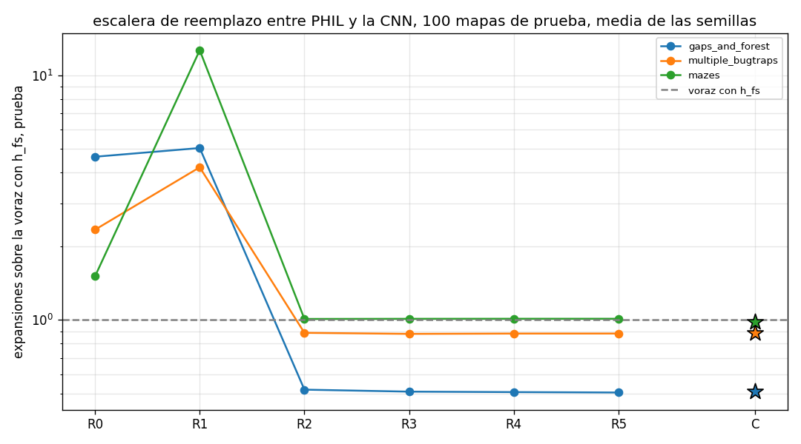
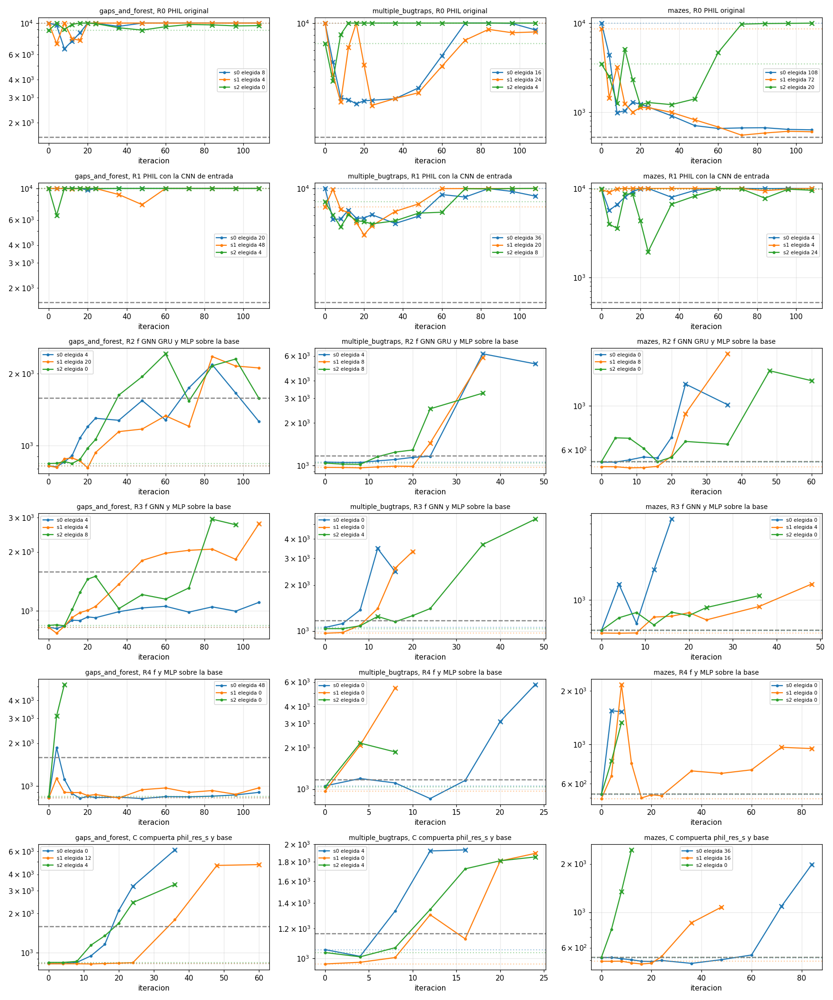

# Resumen de exp_escalera
Carpeta tesis/code_v4, resultados en results\exp_escalera. Borrador generado por resumen_escalera.py, el RESUMEN.md a mano va aparte.

## Escalera en prueba, relacion de expansiones con la voraz con h_fs
| conjunto          | R0    | R1     | R2    | R3    | R4    | R5    | C     |
|-------------------|-------|--------|-------|-------|-------|-------|-------|
| gaps_and_forest   | 4.649 | 5.047  | 0.519 | 0.509 | 0.507 | 0.505 | 0.509 |
| multiple_bugtraps | 2.339 | 4.21   | 0.886 | 0.878 | 0.88  | 0.88  | 0.883 |
| mazes             | 1.509 | 12.665 | 1.01  | 1.011 | 1.012 | 1.012 | 0.981 |

## Comparaciones
| a   | b   | conjunto          | criterio | mapas | exp a  | exp b  | a sobre b | mejora % | p Wilcoxon | mapas donde gana a | a sobre b por semilla | semillas < 1 | camino a sobre b | pasa en el conjunto |
|-----|-----|-------------------|----------|-------|--------|--------|-----------|----------|------------|--------------------|-----------------------|--------------|------------------|---------------------|
| R1  | R0  | gaps_and_forest   | baja     | 91    | 8095.2 | 7456.5 | 1.086     | -8.6     | 0.0        | 26                 | 1.472 1.067 0.811     | 1 de 3       | 0.995            | 0                   |
| R1  | R0  | multiple_bugtraps | baja     | 100   | 4745.7 | 2636.9 | 1.8       | -80.0    | 0.0        | 32                 | 2.614 1.837 1.291     | 0 de 3       | 1.572            | 0                   |
| R1  | R0  | mazes             | baja     | 100   | 5603.2 | 667.4  | 8.396     | -739.6   | 0.0        | 0                  | 10.627 17.355 2.830   | 0 de 3       | 1.863            | 0                   |
| R2  | R1  | gaps_and_forest   | baja     | 91    | 832.7  | 8095.2 | 0.103     | 89.7     | 0.0        | 91                 | 0.087 0.111 0.117     | 3 de 3       | 0.674            | 1                   |
| R2  | R1  | multiple_bugtraps | baja     | 100   | 998.9  | 4745.7 | 0.21      | 79.0     | 0.0        | 79                 | 0.198 0.240 0.201     | 3 de 3       | 0.632            | 1                   |
| R2  | R1  | mazes             | baja     | 100   | 446.8  | 5603.2 | 0.08      | 92.0     | 0.0        | 100                | 0.081 0.052 0.159     | 3 de 3       | 0.541            | 1                   |
| R3  | R2  | gaps_and_forest   | igual    | 91    | 817.2  | 832.7  | 0.981     | 1.9      | 0.0018     | 60                 | 0.978 0.967 0.999     | 3 de 3       | 0.997            | 1                   |
| R3  | R2  | multiple_bugtraps | igual    | 100   | 989.2  | 998.9  | 0.99      | 1.0      | 0.0102     | 63                 | 0.946 1.017 1.016     | 1 de 3       | 0.998            | 1                   |
| R3  | R2  | mazes             | igual    | 100   | 447.3  | 446.8  | 1.001     | -0.1     | 0.0137     | 25                 | 1.000 1.004 1.000     | 0 de 3       | 1.0              | 1                   |
| R4  | R3  | gaps_and_forest   | igual    | 91    | 813.6  | 817.2  | 0.996     | 0.4      | 0.3828     | 44                 | 1.007 0.978 1.001     | 1 de 3       | 0.998            | 1                   |
| R4  | R3  | multiple_bugtraps | igual    | 100   | 992.1  | 989.2  | 1.003     | -0.3     | 0.0003     | 30                 | 1.000 1.000 1.009     | 0 de 3       | 1.0              | 1                   |
| R4  | R3  | mazes             | igual    | 100   | 447.6  | 447.3  | 1.0       | -0.0     | 0.7088     | 26                 | 1.000 1.001 1.000     | 0 de 3       | 1.0              | 1                   |
| R5  | R4  | gaps_and_forest   | igual    | 91    | 810.5  | 813.6  | 0.996     | 0.4      | 0.1052     | 52                 | 0.989 0.999 1.000     | 2 de 3       | 0.999            | 1                   |
| R5  | R4  | multiple_bugtraps | igual    | 100   | 992.3  | 992.1  | 1.0       | -0.0     | 0.1797     | 0                  | 1.000 1.001 1.000     | 0 de 3       | 1.0              | 1                   |
| R5  | R4  | mazes             | igual    | 100   | 447.6  | 447.6  | 1.0       | 0.0      | 1.0        | 0                  | 1.000 1.000 1.000     | 0 de 3       | 1.0              | 1                   |
| C   | R5  | gaps_and_forest   | baja     | 91    | 815.9  | 810.5  | 1.007     | -0.7     | 0.1467     | 42                 | 1.000 1.020 1.000     | 0 de 3       | 1.002            | 0                   |
| C   | R5  | multiple_bugtraps | baja     | 100   | 995.7  | 992.3  | 1.003     | -0.3     | 0.5945     | 48                 | 1.019 0.999 0.991     | 2 de 3       | 1.002            | 0                   |
| C   | R5  | mazes             | baja     | 100   | 434.1  | 447.6  | 0.97      | 3.0      | 0.0        | 71                 | 0.937 0.975 1.000     | 2 de 3       | 1.004            | 0                   |

- R1 contra R0, la CNN aporta a PHIL como entrada. no pasa, baja mas de 5 % con Wilcoxon y 3 de 3 semillas en 0 de 3 conjuntos con datos.
- R2 contra R1, la CNN aporta mas como base que como entrada. pasa, baja mas de 5 % con Wilcoxon y 3 de 3 semillas en 3 de 3 conjuntos con datos.
- R3 contra R2, la CNN puede reemplazar a la GRU. pasa, no queda mas de 5 % peor en 3 de 3 conjuntos con datos.
- R4 contra R3, la CNN puede reemplazar a la GNN. pasa, no queda mas de 5 % peor en 3 de 3 conjuntos con datos.
- R5 contra R4, la CNN puede reemplazar a todo PHIL. pasa, no queda mas de 5 % peor en 3 de 3 conjuntos con datos.
- C contra R5, la compuerta aporta sobre cf_filtro. no pasa, baja mas de 5 % con Wilcoxon y 3 de 3 semillas en 0 de 3 conjuntos con datos.

## Seleccion por corrida
| conjunto          | peldano | semilla | iteracion elegida | val elegida | val iteracion 0 | val h_fs | val cf_filtro mac | mejor aprendida | val mejor aprendida | queda en cf_filtro | sin elegibles | corte | iteracion final | validaciones | parametros entrenables | min entrenamiento | min validacion | listo |
|-------------------|---------|---------|-------------------|-------------|-----------------|----------|-------------------|-----------------|---------------------|--------------------|---------------|-------|-----------------|--------------|------------------------|-------------------|----------------|-------|
| gaps_and_forest   | R0      | 0       | 8                 | 6602.8      | 10000.0         | 1579.2   |                   | None            |                     | 0                  | 1             | 0     | 108             | 14           | 92483                  | 7.0               | 93.1           | 1     |
| gaps_and_forest   | R0      | 1       | 4                 | 7178.4      | 10000.0         | 1579.2   |                   | None            |                     | 0                  | 1             | 0     | 108             | 14           | 92483                  | 6.2               | 76.0           | 1     |
| gaps_and_forest   | R0      | 2       | 0                 | 8903.5      | 8903.5          | 1579.2   |                   | None            |                     | 0                  | 1             | 0     | 108             | 14           | 92483                  | 6.4               | 85.5           | 1     |
| multiple_bugtraps | R0      | 0       | 16                | 2180.0      | 10000.0         | 1163.4   |                   | None            |                     | 0                  | 1             | 0     | 108             | 14           | 92483                  | 7.6               | 52.4           | 1     |
| multiple_bugtraps | R0      | 1       | 24                | 2116.5      | 10000.0         | 1163.4   |                   | None            |                     | 0                  | 1             | 0     | 108             | 14           | 92483                  | 7.1               | 52.0           | 1     |
| multiple_bugtraps | R0      | 2       | 4                 | 3357.3      | 6774.7          | 1163.4   |                   | None            |                     | 0                  | 1             | 0     | 108             | 14           | 92483                  | 7.4               | 87.9           | 1     |
| mazes             | R0      | 0       | 108               | 631.3       | 10000.0         | 523.1    |                   | 108             | 631.3               | 0                  | 0             | 0     | 108             | 14           | 92483                  | 7.5               | 17.4           | 1     |
| mazes             | R0      | 1       | 72                | 550.0       | 8581.1          | 523.1    |                   | 72              | 550.0               | 0                  | 0             | 0     | 108             | 14           | 92483                  | 7.3               | 16.2           | 1     |
| mazes             | R0      | 2       | 20                | 1194.3      | 3455.6          | 523.1    |                   | 20              | 1194.3              | 0                  | 0             | 0     | 108             | 14           | 92483                  | 6.9               | 41.8           | 1     |
| gaps_and_forest   | R1      | 0       | 20                | 9753.3      | 10000.0         | 1579.2   | 822.5             | None            |                     | 0                  | 1             | 0     | 108             | 14           | 97987                  | 7.9               | 213.2          | 1     |
| gaps_and_forest   | R1      | 1       | 48                | 7688.9      | 10000.0         | 1579.2   | 823.2             | None            |                     | 0                  | 1             | 0     | 108             | 14           | 97987                  | 7.8               | 202.0          | 1     |
| gaps_and_forest   | R1      | 2       | 4                 | 6475.5      | 10000.0         | 1579.2   | 835.1             | None            |                     | 0                  | 1             | 0     | 108             | 14           | 97987                  | 6.9               | 191.7          | 1     |
| multiple_bugtraps | R1      | 0       | 36                | 5162.6      | 9974.9          | 1163.4   | 1072.3            | None            |                     | 0                  | 1             | 0     | 108             | 14           | 97987                  | 8.7               | 163.5          | 1     |
| multiple_bugtraps | R1      | 1       | 20                | 4168.2      | 7080.9          | 1163.4   | 970.6             | None            |                     | 0                  | 1             | 0     | 108             | 14           | 97987                  | 8.8               | 166.6          | 1     |
| multiple_bugtraps | R1      | 2       | 8                 | 4846.2      | 7751.1          | 1163.4   | 1032.9            | None            |                     | 0                  | 1             | 0     | 108             | 14           | 97987                  | 8.3               | 147.5          | 1     |
| mazes             | R1      | 0       | 4                 | 5659.9      | 9876.5          | 523.1    | 520.7             | None            |                     | 0                  | 1             | 0     | 108             | 14           | 97987                  | 8.0               | 194.3          | 1     |
| mazes             | R1      | 1       | 4                 | 9033.8      | 9748.4          | 523.1    | 493.5             | None            |                     | 0                  | 1             | 0     | 108             | 14           | 97987                  | 7.6               | 190.1          | 1     |
| mazes             | R1      | 2       | 24                | 1947.1      | 9840.3          | 523.1    | 523.1             | None            |                     | 0                  | 1             | 0     | 108             | 14           | 97987                  | 6.5               | 149.5          | 1     |
| gaps_and_forest   | R2      | 0       | 4                 | 815.4       | 822.7           | 1579.2   | 822.5             | 4               | 815.4               | 0                  | 0             | 0     | 108             | 14           | 97987                  | 8.1               | 36.7           | 1     |
| gaps_and_forest   | R2      | 1       | 20                | 806.7       | 821.4           | 1579.2   | 823.2             | 20              | 806.7               | 0                  | 0             | 0     | 108             | 14           | 97987                  | 8.3               | 37.0           | 1     |
| gaps_and_forest   | R2      | 2       | 0                 | 841.0       | 841.0           | 1579.2   | 835.1             | 12              | 841.9               | 1                  | 0             | 0     | 108             | 14           | 97987                  | 7.6               | 39.8           | 1     |
| multiple_bugtraps | R2      | 0       | 4                 | 1046.9      | 1054.9          | 1163.4   | 1072.3            | 4               | 1046.9              | 0                  | 0             | 1     | 48              | 9            | 97987                  | 2.1               | 36.8           | 1     |
| multiple_bugtraps | R2      | 1       | 8                 | 958.9       | 966.9           | 1163.4   | 970.6             | 8               | 958.9               | 0                  | 0             | 1     | 36              | 8            | 97987                  | 1.3               | 28.0           | 1     |
| multiple_bugtraps | R2      | 2       | 8                 | 1016.0      | 1036.4          | 1163.4   | 1032.9            | 8               | 1016.0              | 0                  | 0             | 1     | 36              | 8            | 97987                  | 1.1               | 25.3           | 1     |
| mazes             | R2      | 0       | 0                 | 520.1       | 520.1           | 523.1    | 520.7             | 4               | 520.7               | 1                  | 0             | 1     | 36              | 8            | 97987                  | 1.2               | 12.9           | 1     |
| mazes             | R2      | 1       | 8                 | 487.0       | 493.9           | 523.1    | 493.5             | 8               | 487.0               | 0                  | 0             | 1     | 36              | 8            | 97987                  | 1.2               | 12.9           | 1     |
| mazes             | R2      | 2       | 0                 | 523.1       | 523.1           | 523.1    | 523.1             | 16              | 523.1               | 1                  | 0             | 1     | 60              | 10           | 97987                  | 3.1               | 17.7           | 1     |
| gaps_and_forest   | R3      | 0       | 4                 | 810.8       | 822.7           | 1579.2   | 822.5             | 4               | 810.8               | 0                  | 0             | 0     | 108             | 14           | 73027                  | 6.1               | 25.9           | 1     |
| gaps_and_forest   | R3      | 1       | 4                 | 767.1       | 821.4           | 1579.2   | 823.2             | 4               | 767.1               | 0                  | 0             | 0     | 108             | 14           | 73027                  | 6.5               | 35.7           | 1     |
| gaps_and_forest   | R3      | 2       | 8                 | 837.6       | 841.0           | 1579.2   | 835.1             | 8               | 837.6               | 0                  | 0             | 1     | 96              | 13           | 73027                  | 5.5               | 34.4           | 1     |
| multiple_bugtraps | R3      | 0       | 0                 | 1054.9      | 1054.9          | 1163.4   | 1072.3            | 4               | 1118.5              | 1                  | 0             | 1     | 16              | 5            | 73027                  | 0.2               | 16.4           | 1     |
| multiple_bugtraps | R3      | 1       | 0                 | 966.9       | 966.9           | 1163.4   | 970.6             | 4               | 977.0               | 1                  | 0             | 1     | 20              | 6            | 73027                  | 0.3               | 19.1           | 1     |
| multiple_bugtraps | R3      | 2       | 4                 | 1036.0      | 1036.4          | 1163.4   | 1032.9            | 4               | 1036.0              | 0                  | 0             | 1     | 48              | 9            | 73027                  | 1.6               | 31.2           | 1     |
| mazes             | R3      | 0       | 0                 | 520.1       | 520.1           | 523.1    | 520.7             | None            |                     | 1                  | 0             | 1     | 16              | 5            | 73027                  | 0.2               | 17.2           | 1     |
| mazes             | R3      | 1       | 4                 | 491.8       | 493.9           | 523.1    | 493.5             | 4               | 491.8               | 0                  | 0             | 1     | 48              | 9            | 73027                  | 1.6               | 13.2           | 1     |
| mazes             | R3      | 2       | 0                 | 523.1       | 523.1           | 523.1    | 523.1             | 12              | 585.8               | 1                  | 0             | 1     | 36              | 8            | 73027                  | 1.0               | 13.0           | 1     |
| gaps_and_forest   | R4      | 0       | 48                | 813.3       | 822.7           | 1579.2   | 822.5             | 48              | 813.3               | 0                  | 0             | 0     | 108             | 14           | 56385                  | 4.5               | 20.5           | 1     |
| gaps_and_forest   | R4      | 1       | 0                 | 821.4       | 821.4           | 1579.2   | 823.2             | 36              | 821.7               | 1                  | 0             | 0     | 108             | 14           | 56385                  | 4.5               | 20.4           | 1     |
| gaps_and_forest   | R4      | 2       | 0                 | 841.0       | 841.0           | 1579.2   | 835.1             | 4               | 3110.6              | 1                  | 0             | 1     | 8               | 3            | 56385                  | 0.1               | 12.5           | 1     |
| multiple_bugtraps | R4      | 0       | 0                 | 1054.9      | 1054.9          | 1163.4   | 1072.3            | 16              | 1155.9              | 1                  | 0             | 1     | 24              | 7            | 56385                  | 0.4               | 21.0           | 1     |
| multiple_bugtraps | R4      | 1       | 0                 | 966.9       | 966.9           | 1163.4   | 970.6             | 4               | 2085.9              | 1                  | 0             | 1     | 8               | 3            | 56385                  | 0.1               | 12.4           | 1     |
| multiple_bugtraps | R4      | 2       | 0                 | 1036.4      | 1036.4          | 1163.4   | 1032.9            | 8               | 1862.2              | 1                  | 0             | 1     | 8               | 3            | 56385                  | 0.1               | 7.4            | 1     |
| mazes             | R4      | 0       | 0                 | 520.1       | 520.1           | 523.1    | 520.7             | 8               | 1525.7              | 1                  | 0             | 1     | 8               | 3            | 56385                  | 0.1               | 4.9            | 1     |
| mazes             | R4      | 1       | 0                 | 493.9       | 493.9           | 523.1    | 493.5             | 16              | 497.8               | 1                  | 0             | 1     | 84              | 12           | 56385                  | 3.3               | 16.2           | 1     |
| mazes             | R4      | 2       | 0                 | 523.1       | 523.1           | 523.1    | 523.1             | 4               | 804.3               | 1                  | 0             | 1     | 8               | 3            | 56385                  | 0.1               | 4.7            | 1     |
| gaps_and_forest   | C       | 0       | 0                 | 822.7       | 822.7           | 1579.2   | 822.5             | 4               | 822.7               | 1                  | 0             | 1     | 36              | 8            | 29441                  | 0.8               | 34.4           | 1     |
| gaps_and_forest   | C       | 1       | 12                | 818.6       | 821.4           | 1579.2   | 823.2             | 12              | 818.6               | 0                  | 0             | 1     | 60              | 10           | 29441                  | 2.0               | 34.7           | 1     |
| gaps_and_forest   | C       | 2       | 4                 | 840.9       | 841.0           | 1579.2   | 835.1             | 4               | 840.9               | 0                  | 0             | 1     | 36              | 8            | 29441                  | 0.8               | 25.3           | 1     |
| multiple_bugtraps | C       | 0       | 4                 | 1012.7      | 1054.9          | 1163.4   | 1072.3            | 4               | 1012.7              | 0                  | 0             | 1     | 16              | 5            | 29441                  | 0.2               | 16.6           | 1     |
| multiple_bugtraps | C       | 1       | 0                 | 966.9       | 966.9           | 1163.4   | 970.6             | 4               | 976.7               | 1                  | 0             | 1     | 24              | 7            | 29441                  | 0.4               | 20.9           | 1     |
| multiple_bugtraps | C       | 2       | 4                 | 1009.7      | 1036.4          | 1163.4   | 1032.9            | 4               | 1009.7              | 0                  | 0             | 1     | 24              | 7            | 29441                  | 0.4               | 22.1           | 1     |
| mazes             | C       | 0       | 36                | 479.2       | 520.1           | 523.1    | 520.7             | 36              | 479.2               | 0                  | 0             | 1     | 84              | 12           | 29441                  | 4.0               | 19.1           | 1     |
| mazes             | C       | 1       | 16                | 475.3       | 493.9           | 523.1    | 493.5             | 16              | 475.3               | 0                  | 0             | 1     | 48              | 9            | 29441                  | 1.5               | 13.3           | 1     |
| mazes             | C       | 2       | 0                 | 523.1       | 523.1           | 523.1    | 523.1             | 4               | 779.9               | 1                  | 0             | 1     | 12              | 4            | 29441                  | 0.1               | 10.6           | 1     |

## Figuras

Mapas de alpha en figuras/alpha_<conjunto>.png y alpha por tramo en figuras/alpha_tramos.png si figuras_escalera.py corrio.

## Que funciono

(pendiente de revisar)

## Que no funciono

(pendiente de revisar)

## Lo que necesita tu decision

(pendiente de revisar)
