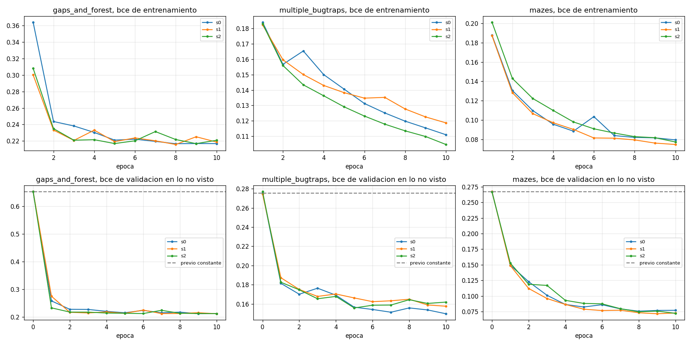
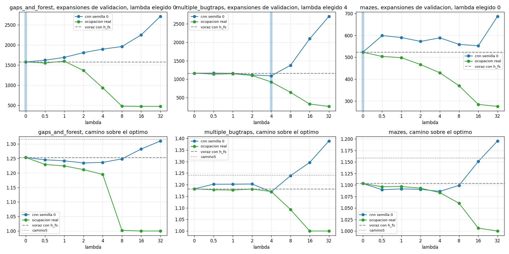
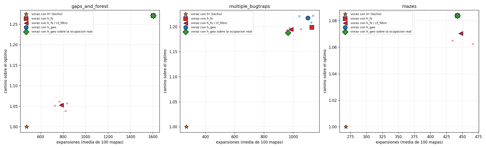
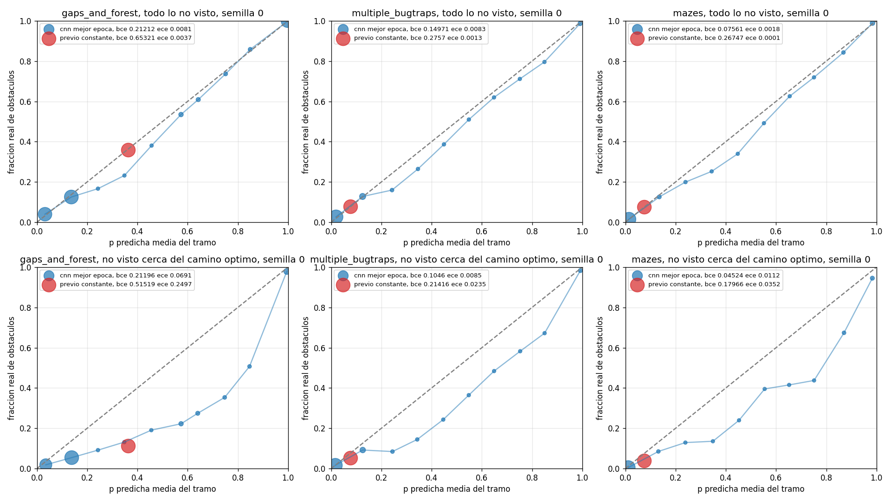
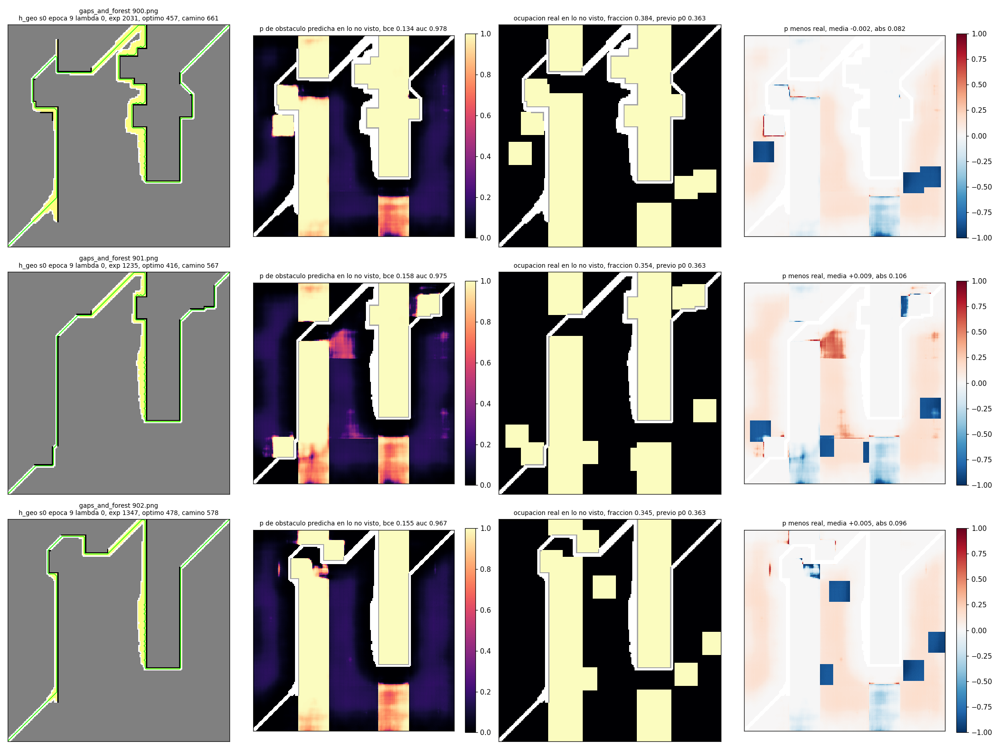
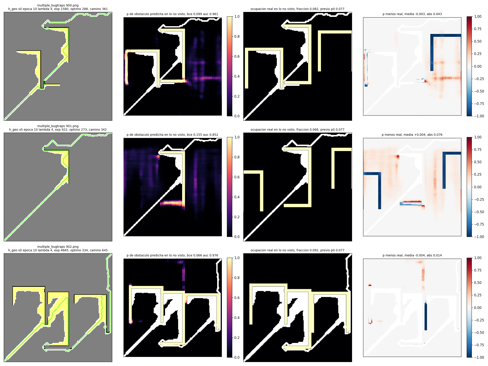
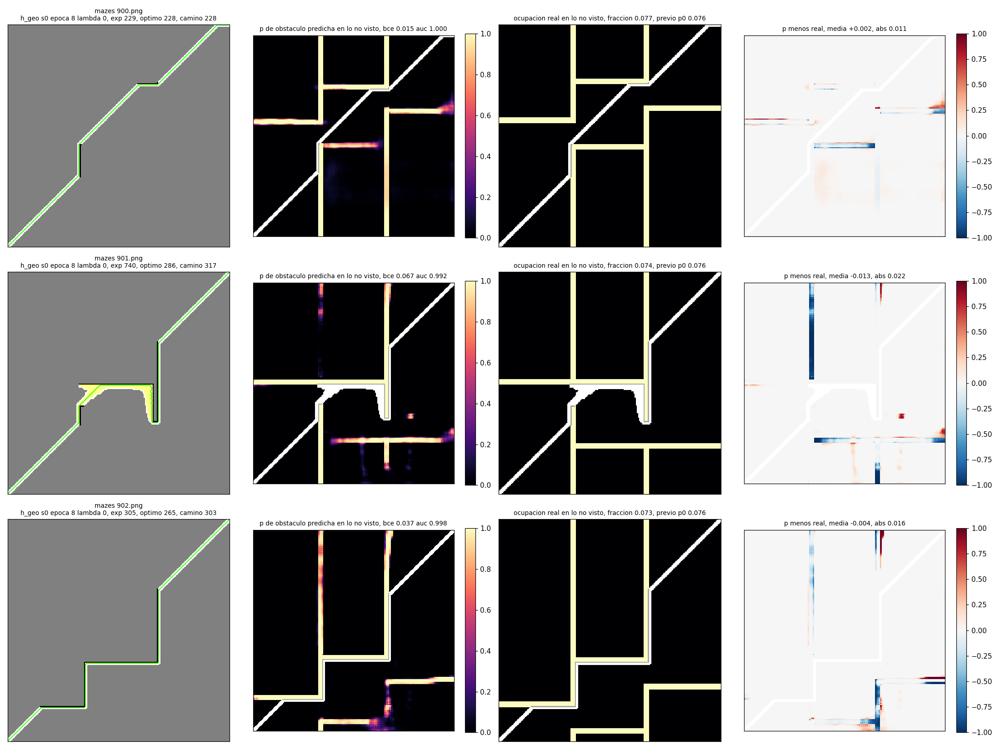

# Resumen de exp_geo. Corrida completa del 2026-11-05 en Windows con una RTX 4070

Escrito a mano el 2026-11-05 al terminar el maestro, leyendo results/exp_geo. Todo número de resultados y de tiempos sale de tablas.md, resumen.csv, seleccion.csv, base.json, barrido/<conjunto>/lambda.json, metricas/<conjunto>/geo_s<k>.csv, checks/*.csv, runs/<conjunto>/geo_s<k>/train.csv, figuras/geo_stats.csv, maestro.log y logs/memoria.log. El borrador automático quedó en RESUMEN_auto.md y las tablas completas en tablas.md. Los datos de la máquina y de las versiones salen del README y no de results.

## En pocas líneas

- El paso 1 pasa en los tres conjuntos y por mucho. En validación la BCE sobre lo no visto baja de 0.6532 a 0.2121 en gaps_and_forest, de 0.2757 a 0.1497 en multiple_bugtraps y de 0.2675 a 0.0756 en mazes, semilla 0, con AUC 0.9462, 0.9092 y 0.9716. Las tres semillas ganan al previo en los tres conjuntos.
- El paso 2 no pasa en ninguno. El barrido eligió lambda 0 en gaps_and_forest y en mazes, así que ahí h_geo es h_fs y la relación en prueba es 1.000. En multiple_bugtraps eligió lambda 4 y en prueba da 0.975 con semillas 1.007, 0.996 y 0.923, p de Wilcoxon 0.1766 y camino 1.56 % peor.
- La mecánica sí sirve cuando la geometría es la real. Con la ocupación real en vez de la CNN el barrido llega a 0.302 en gaps_and_forest, 0.228 en multiple_bugtraps y 0.527 en mazes, y en prueba de multiple_bugtraps con el lambda 4 elegido da 0.856. La brecha está en la CNN, casi perfecta a 1 a 3 celdas de la frontera y mucho más floja a 16 o más, donde está entre el 74 y el 82 % de las celdas no vistas.
- La base del paso 3 por la regla del protocolo es cf_filtro en los tres conjuntos. En validación cf_filtro expande 826.9 contra 1579.2 de h_geo en gaps_and_forest, 1025.3 contra 1085.4 en multiple_bugtraps y 512.4 contra 523.1 en mazes.
- La corrida duró 153 minutos de reloj, de 9h53 a 12h27, sin ningún fallo ni reintento marcado, con 139 latidos del vigía y ningún aviso de paginado, solo tres latidos con paginado distinto de cero y ninguno por encima de los 40 MB por segundo del aviso.

## Cómo se corrió

Laptop con Windows 11, 16 GB de RAM, 20 hilos y una RTX 4070 de 8 GB. Git Bash, Python 3.14 y torch 2.12.0 con CUDA 13.0. Entrenamiento en la GPU con DEVICE=cuda, todas las búsquedas en CPU con un hilo. La orden fue

```bash
DEVICE=cuda nohup bash experiments/run_geo.sh >> results/exp_geo/maestro.log 2>&1 &
```

más experiments/despierto.py para que la laptop no se suspendiera. Lo que hubo que adaptar para Windows está en el README, en la sección sobre Git Bash. Nada de eso cambia el protocolo. Las pruebas pasaron a las 9h54, 8 de 8 y 13 de 13. Las verificaciones previas pasaron a las 10h06, las tres cadenas arrancaron a las 10h06, mazes terminó a las 10h56, gaps_and_forest a las 12h05 y multiple_bugtraps a las 12h26. El resumen y las figuras tardaron un minuto.

Un detalle de Windows para leer los logs. Las tres cadenas escriben a la vez en trabajos.log y ahí el agregado al final del archivo no es atómico entre procesos, así que algunas líneas quedaron pisadas o cortadas. No afecta a ningún resultado porque cada trabajo escribe sus csv y marcadores en archivos propios. La línea de tiempo de este resumen sale de las horas de modificación de esos archivos y de maestro.log.

## Verificaciones previas

| verificación | gaps_and_forest | multiple_bugtraps | mazes |
|---|---|---|---|
| CNN recién construida da logit(p0) exacto, igual en cpu y en cuda | pasa, diferencia 0 | pasa, diferencia 0 | pasa, diferencia 0 |
| fuga, 200 celdas no vistas cambiadas en 3 mapas, CNN, cf_filtro y h_geo iguales | 3 de 3 | 3 de 3 | 3 de 3 |
| época 0 con lambda 0 igual a la voraz con h_fs, con la CNN corriendo | 91 de 91 | 100 de 100 | 100 de 100 |
| época 0 con lambda 0 igual a la voraz con h_fs, con la ocupación real | 91 de 91 | 100 de 100 | 100 de 100 |
| lambda 0 del barrido igual a h_fs mapa por mapa en validación | sí | sí | sí |

Tiempo por nodo a solas en los primeros 10 mapas de prueba, 9 resolubles en gaps_and_forest, antes de lanzar las cadenas.

| conjunto | búsqueda | ms por nodo | ms de red por nodo | s por mapa |
|---|---|---|---|---|
| gaps_and_forest | voraz con h_fs | 0.373 | 0.0 | 0.613 |
| gaps_and_forest | cf_filtro semilla 0 | 3.448 | 3.218 | 2.606 |
| gaps_and_forest | h_geo con la CNN, lambda 4 | 3.153 | 2.806 | 6.384 |
| gaps_and_forest | h_geo con la ocupación real, lambda 4 | 0.277 | 0.0 | 0.285 |
| multiple_bugtraps | voraz con h_fs | 0.385 | 0.0 | 0.638 |
| multiple_bugtraps | cf_filtro semilla 0 | 4.651 | 4.301 | 7.224 |
| multiple_bugtraps | h_geo con la CNN, lambda 4 | 3.531 | 3.145 | 6.895 |
| multiple_bugtraps | h_geo con la ocupación real, lambda 4 | 0.291 | 0.0 | 0.398 |
| mazes | voraz con h_fs | 0.391 | 0.0 | 0.160 |
| mazes | cf_filtro semilla 0 | 4.013 | 3.705 | 1.636 |
| mazes | h_geo con la CNN, lambda 4 | 3.835 | 3.441 | 1.781 |
| mazes | h_geo con la ocupación real, lambda 4 | 0.349 | 0.0 | 0.121 |

La red se lleva casi todo el costo de h_geo, igual que en cf_filtro. El Dijkstra con pesos sale barato, h_geo con la ocupación real cuesta menos por nodo que la voraz con h_fs.

## Paso 1. La CNN de geometría contra el previo constante

Fotos de validación, celdas no vistas, mejor época de cada semilla. todo es lo no visto completo y corredor es lo no visto a 10 saltos del camino óptimo dilatado 3 celdas.

| conjunto | semilla | estrato | celdas | fracción de obstáculo | BCE previo | BCE CNN | mejora BCE % | AUC CNN | ECE previo | ECE CNN |
|---|---|---|---|---|---|---|---|---|---|---|
| gaps_and_forest | 0 | todo | 124180278 | 0.360 | 0.6532 | 0.2121 | 67.5 | 0.9462 | 0.0037 | 0.0081 |
| gaps_and_forest | 0 | corredor | 53356752 | 0.114 | 0.5152 | 0.2120 | 58.9 | 0.8829 | 0.2497 | 0.0691 |
| gaps_and_forest | 1 | todo | 124091693 | 0.359 | 0.6531 | 0.2119 | 67.6 | 0.9457 | 0.0036 | 0.0036 |
| gaps_and_forest | 1 | corredor | 53276053 | 0.113 | 0.5145 | 0.2106 | 59.1 | 0.8809 | 0.2503 | 0.0660 |
| gaps_and_forest | 2 | todo | 124670756 | 0.359 | 0.6531 | 0.2123 | 67.5 | 0.9455 | 0.0037 | 0.0069 |
| gaps_and_forest | 2 | corredor | 53560373 | 0.113 | 0.5145 | 0.2157 | 58.1 | 0.8805 | 0.2503 | 0.0732 |
| multiple_bugtraps | 0 | todo | 123769945 | 0.079 | 0.2757 | 0.1497 | 45.7 | 0.9092 | 0.0013 | 0.0083 |
| multiple_bugtraps | 0 | corredor | 38641067 | 0.054 | 0.2142 | 0.1046 | 51.2 | 0.9253 | 0.0235 | 0.0085 |
| multiple_bugtraps | 1 | todo | 118712078 | 0.078 | 0.2745 | 0.1576 | 42.6 | 0.8978 | 0.0009 | 0.0048 |
| multiple_bugtraps | 1 | corredor | 36534737 | 0.053 | 0.2118 | 0.1056 | 50.2 | 0.9206 | 0.0244 | 0.0094 |
| multiple_bugtraps | 2 | todo | 121320109 | 0.079 | 0.2771 | 0.1557 | 43.8 | 0.9018 | 0.0016 | 0.0020 |
| multiple_bugtraps | 2 | corredor | 37902779 | 0.053 | 0.2125 | 0.1080 | 49.2 | 0.9230 | 0.0246 | 0.0124 |
| mazes | 0 | todo | 60636664 | 0.075 | 0.2675 | 0.0756 | 71.7 | 0.9716 | 0.0001 | 0.0018 |
| mazes | 0 | corredor | 19555098 | 0.040 | 0.1797 | 0.0452 | 74.8 | 0.9871 | 0.0352 | 0.0112 |
| mazes | 1 | todo | 59140320 | 0.075 | 0.2673 | 0.0715 | 73.2 | 0.9742 | 0.0001 | 0.0008 |
| mazes | 1 | corredor | 19178639 | 0.040 | 0.1791 | 0.0438 | 75.6 | 0.9868 | 0.0353 | 0.0120 |
| mazes | 2 | todo | 30376080 | 0.075 | 0.2666 | 0.0722 | 72.9 | 0.9753 | 0.0001 | 0.0015 |
| mazes | 2 | corredor | 9952875 | 0.039 | 0.1771 | 0.0397 | 77.6 | 0.9900 | 0.0357 | 0.0096 |

Regla del paso 1. La CNN gana al previo en BCE de validación en 3 de 3 semillas en los tres conjuntos. Pasa.

Por distancia a la frontera, semilla 0. Es la tabla que explica el paso 2. La CNN acierta casi todo en las celdas pegadas a lo visto y pierde buena parte de la ventaja lejos de la frontera, y lejos de la frontera está la mayoría de las celdas.

| conjunto | distancia a la frontera | celdas | fracción de obstáculo | BCE previo | BCE CNN | mejora BCE % | AUC CNN |
|---|---|---|---|---|---|---|---|
| gaps_and_forest | 1 | 2418289 | 0.279 | 0.6077 | 0.0102 | 98.3 | 0.9990 |
| gaps_and_forest | 2 a 3 | 4748956 | 0.305 | 0.6227 | 0.0317 | 94.9 | 0.9960 |
| gaps_and_forest | 4 a 7 | 9136136 | 0.355 | 0.6508 | 0.0790 | 87.9 | 0.9867 |
| gaps_and_forest | 8 a 15 | 16425985 | 0.437 | 0.6967 | 0.1611 | 76.9 | 0.9642 |
| gaps_and_forest | 16 o más | 91450912 | 0.351 | 0.6484 | 0.2493 | 61.6 | 0.9245 |
| multiple_bugtraps | 1 | 2090014 | 0.229 | 0.6483 | 0.0022 | 99.7 | 0.9998 |
| multiple_bugtraps | 2 a 3 | 4021077 | 0.233 | 0.6572 | 0.0080 | 98.8 | 0.9994 |
| multiple_bugtraps | 4 a 7 | 7584015 | 0.141 | 0.4299 | 0.0346 | 91.9 | 0.9955 |
| multiple_bugtraps | 8 a 15 | 14034919 | 0.053 | 0.2130 | 0.1074 | 49.6 | 0.9376 |
| multiple_bugtraps | 16 o más | 96039920 | 0.068 | 0.2486 | 0.1741 | 30.0 | 0.8593 |
| mazes | 1 | 731463 | 0.204 | 0.5894 | 0.0016 | 99.7 | 1.0000 |
| mazes | 2 a 3 | 1447795 | 0.216 | 0.6193 | 0.0033 | 99.5 | 1.0000 |
| mazes | 4 a 7 | 2871049 | 0.093 | 0.3121 | 0.0150 | 95.2 | 0.9992 |
| mazes | 8 a 15 | 5680338 | 0.062 | 0.2343 | 0.0277 | 88.2 | 0.9963 |
| mazes | 16 o más | 49906019 | 0.070 | 0.2537 | 0.0877 | 65.4 | 0.9585 |

Las celdas a 16 o más de la frontera son 91450912 de 124180278 en gaps_and_forest, 96039920 de 123769945 en multiple_bugtraps y 49906019 de 60636664 en mazes, o sea el 74, el 78 y el 82 % de lo no visto. Las semillas 1 y 2 repiten el patrón, ganan al previo en los cinco tramos y la mejora y el AUC bajan con la distancia, con diferencias respecto de la semilla 0 que llegan a la segunda cifra, por ejemplo BCE 0.1074, 0.1230 y 0.1213 en multiple_bugtraps de 8 a 15. Están en tablas.md.

Selección por semilla, época de menor BCE en validación. Ninguna semilla se cortó por derrumbe.

| conjunto | semilla | época elegida | BCE val elegida | BCE val previo | p0 | fotos de entrenamiento | de ellas de cf_filtro | fotos de validación | pérdida época 1 | pérdida final | min de entrenamiento | min de validación |
|---|---|---|---|---|---|---|---|---|---|---|---|---|
| gaps_and_forest | 0 | 9 | 0.21212 | 0.65321 | 0.3633 | 9100 | 3118 | 3188 | 0.36416 | 0.21680 | 13.0 | 3.5 |
| gaps_and_forest | 1 | 10 | 0.21188 | 0.65311 | 0.3630 | 9075 | 3093 | 3186 | 0.30021 | 0.21866 | 8.7 | 2.8 |
| gaps_and_forest | 2 | 10 | 0.21227 | 0.65309 | 0.3631 | 9197 | 3215 | 3201 | 0.30818 | 0.22078 | 8.8 | 2.9 |
| multiple_bugtraps | 0 | 10 | 0.14971 | 0.27570 | 0.0774 | 10242 | 4961 | 3203 | 0.18409 | 0.11097 | 15.4 | 3.7 |
| multiple_bugtraps | 1 | 10 | 0.15756 | 0.27451 | 0.0774 | 9998 | 4717 | 3056 | 0.18237 | 0.11869 | 9.3 | 2.5 |
| multiple_bugtraps | 2 | 5 | 0.15575 | 0.27714 | 0.0777 | 10077 | 4796 | 3140 | 0.18319 | 0.10463 | 9.2 | 2.4 |
| mazes | 0 | 8 | 0.07561 | 0.26747 | 0.0755 | 3770 | 1907 | 1531 | 0.18775 | 0.07957 | 3.4 | 1.1 |
| mazes | 1 | 9 | 0.07150 | 0.26728 | 0.0755 | 3668 | 1805 | 1494 | 0.18715 | 0.07481 | 8.6 | 2.2 |
| mazes | 2 | 10 | 0.07219 | 0.26656 | 0.0751 | 1863 | 0 | 768 | 0.20113 | 0.07742 | 4.0 | 1.1 |

Cinco semillas eligieron la época 10, la última, gaps_and_forest 1 y 2, multiple_bugtraps 0 y 1 y mazes 2, con la curva de validación todavía bajando despacio, y multiple_bugtraps semilla 2 eligió la 5 con las épocas 6 a 10 entre 0.1586 y 0.1644. En mazes el cf_filtro de la semilla 2 es h_fs, así que esa semilla entrenó solo con las 1863 fotos base y aun así quedó segunda en BCE en todo lo no visto, 0.0722 contra 0.0715 de la semilla 1, y fue la mejor de las tres en el corredor con 0.0397.



## Barrido de lambda en validación

Semilla 0, 70 mapas de validación, 65 resolubles en gaps_and_forest. real es h_geo con la ocupación real en vez de la CNN. La elección se hace con camino5 sobre las corridas de la CNN, con lambda 0 como candidata, y si ninguna le gana a h_fs queda lambda 0.



gaps_and_forest. h_fs expande 1579.2 con camino 1.253. lambda elegido 0.

| quién | lambda | expansiones | relación con h_fs | camino | encontrados | elegible | ms por nodo |
|---|---|---|---|---|---|---|---|
| CNN semilla 0 | 0 | 1579.2 | 1.000 | 1.253 | 65 | 1 | 7.34 |
| CNN semilla 0 | 0.5 | 1624.1 | 1.028 | 1.245 | 65 | 1 | 7.32 |
| CNN semilla 0 | 1 | 1692.8 | 1.072 | 1.242 | 65 | 1 | 6.00 |
| CNN semilla 0 | 2 | 1812.6 | 1.148 | 1.235 | 65 | 1 | 5.55 |
| CNN semilla 0 | 4 | 1898.6 | 1.202 | 1.236 | 65 | 1 | 5.75 |
| CNN semilla 0 | 8 | 1963.6 | 1.243 | 1.249 | 65 | 1 | 5.68 |
| CNN semilla 0 | 16 | 2252.2 | 1.426 | 1.283 | 65 | 1 | 5.73 |
| CNN semilla 0 | 32 | 2712.6 | 1.718 | 1.310 | 65 | 1 | 5.46 |
| ocupación real | 0 | 1579.2 | 1.000 | 1.253 | 65 | 1 | 0.51 |
| ocupación real | 0.5 | 1554.2 | 0.984 | 1.229 | 65 | 1 | 0.65 |
| ocupación real | 1 | 1600.5 | 1.013 | 1.224 | 65 | 1 | 0.63 |
| ocupación real | 2 | 1368.2 | 0.866 | 1.212 | 65 | 1 | 0.47 |
| ocupación real | 4 | 939.5 | 0.595 | 1.195 | 65 | 1 | 0.42 |
| ocupación real | 8 | 482.0 | 0.305 | 1.002 | 65 | 1 | 0.50 |
| ocupación real | 16 | 476.5 | 0.302 | 1.000 | 65 | 1 | 0.51 |
| ocupación real | 32 | 476.5 | 0.302 | 1.000 | 65 | 1 | 0.51 |

multiple_bugtraps. h_fs expande 1163.4 con camino 1.182. lambda elegido 4.

| quién | lambda | expansiones | relación con h_fs | camino | encontrados | elegible | ms por nodo |
|---|---|---|---|---|---|---|---|
| CNN semilla 0 | 0 | 1163.4 | 1.000 | 1.182 | 70 | 1 | 5.79 |
| CNN semilla 0 | 0.5 | 1165.6 | 1.002 | 1.202 | 70 | 1 | 5.81 |
| CNN semilla 0 | 1 | 1160.2 | 0.997 | 1.202 | 70 | 1 | 5.57 |
| CNN semilla 0 | 2 | 1114.2 | 0.958 | 1.203 | 70 | 1 | 5.49 |
| CNN semilla 0 | 4 | 1092.0 | 0.939 | 1.169 | 70 | 1 | 6.10 |
| CNN semilla 0 | 8 | 1376.0 | 1.183 | 1.239 | 70 | 1 | 6.13 |
| CNN semilla 0 | 16 | 2096.3 | 1.802 | 1.296 | 70 | 0 | 5.67 |
| CNN semilla 0 | 32 | 2700.3 | 2.321 | 1.389 | 65 | 0 | 5.07 |
| ocupación real | 0 | 1163.4 | 1.000 | 1.182 | 70 | 1 | 0.51 |
| ocupación real | 0.5 | 1137.4 | 0.978 | 1.178 | 70 | 1 | 0.43 |
| ocupación real | 1 | 1148.4 | 0.987 | 1.177 | 70 | 1 | 0.44 |
| ocupación real | 2 | 1103.3 | 0.948 | 1.181 | 70 | 1 | 0.47 |
| ocupación real | 4 | 925.7 | 0.796 | 1.171 | 70 | 1 | 0.45 |
| ocupación real | 8 | 644.7 | 0.554 | 1.093 | 70 | 1 | 0.44 |
| ocupación real | 16 | 327.6 | 0.282 | 1.000 | 70 | 1 | 0.41 |
| ocupación real | 32 | 265.4 | 0.228 | 1.000 | 70 | 1 | 0.27 |

mazes. h_fs expande 523.1 con camino 1.103. lambda elegido 0.

| quién | lambda | expansiones | relación con h_fs | camino | encontrados | elegible | ms por nodo |
|---|---|---|---|---|---|---|---|
| CNN semilla 0 | 0 | 523.1 | 1.000 | 1.103 | 70 | 1 | 5.48 |
| CNN semilla 0 | 0.5 | 599.1 | 1.145 | 1.090 | 70 | 1 | 5.59 |
| CNN semilla 0 | 1 | 590.2 | 1.128 | 1.091 | 70 | 1 | 5.42 |
| CNN semilla 0 | 2 | 572.5 | 1.095 | 1.090 | 70 | 1 | 5.43 |
| CNN semilla 0 | 4 | 588.8 | 1.126 | 1.086 | 70 | 1 | 5.68 |
| CNN semilla 0 | 8 | 559.1 | 1.069 | 1.099 | 70 | 1 | 5.18 |
| CNN semilla 0 | 16 | 552.5 | 1.056 | 1.151 | 70 | 1 | 5.80 |
| CNN semilla 0 | 32 | 687.0 | 1.313 | 1.196 | 70 | 0 | 5.92 |
| ocupación real | 0 | 523.1 | 1.000 | 1.103 | 70 | 1 | 0.41 |
| ocupación real | 0.5 | 503.9 | 0.963 | 1.096 | 70 | 1 | 0.50 |
| ocupación real | 1 | 498.1 | 0.952 | 1.097 | 70 | 1 | 0.47 |
| ocupación real | 2 | 466.6 | 0.892 | 1.093 | 70 | 1 | 0.49 |
| ocupación real | 4 | 429.2 | 0.821 | 1.083 | 70 | 1 | 0.46 |
| ocupación real | 8 | 369.8 | 0.707 | 1.060 | 70 | 1 | 0.40 |
| ocupación real | 16 | 284.3 | 0.544 | 1.006 | 70 | 1 | 0.34 |
| ocupación real | 32 | 275.4 | 0.527 | 1.000 | 70 | 1 | 0.37 |

Lo que dicen las curvas. Con la ocupación real las expansiones bajan con lambda en los tres conjuntos, de forma monótona en mazes y con un repunte en lambda 1 en gaps_and_forest, 1600.5, y en multiple_bugtraps, 1148.4, y el camino se acerca al óptimo, con lambda 16 ya casi es la voraz con h*. Con la CNN pasa lo contrario en gaps_and_forest y en mazes, cualquier lambda mayor que 0 expande más que h_fs, y en multiple_bugtraps hay un valle angosto entre lambda 2 y 4 que da 0.939 y un precipicio en lambda 8 que da 1.183. El camino con la CNN sí mejora un poco para lambdas chicos, 1.235 contra 1.253 en gaps_and_forest con lambda 2, pero camino5 no decide, decide la cantidad de expansiones.

## Paso 2. Prueba en los 100 mapas de cada conjunto

91 resolubles en gaps_and_forest, tope de 10 000 expansiones. Relación es expansiones sobre las de la voraz con h_fs. Camino es el largo sobre el óptimo en los mapas encontrados. p es Wilcoxon pareado por mapa sobre la media de las semillas. Los ms por nodo de h_geo se midieron en esta corrida con otras cadenas a la vez, tres durante la prueba de mazes y dos o una después, y valen solo como orden de magnitud. Los de h*, h_fs y cf_filtro se leen de code_v3 y se midieron en la Mac, no se comparan con estos. Las filas de h_geo usan el lambda elegido en validación, 0, 4 y 0.

gaps_and_forest

| búsqueda | semillas | expansiones | desvío entre semillas | relación con h_fs | por semilla | semillas < 1 | mejora % | p exp | camino sobre óptimo | camino vs h_fs % | p camino | ms por nodo | época elegida |
|---|---|---|---|---|---|---|---|---|---|---|---|---|---|
| voraz con h* (techo) | 0 | 474.0 | 0.0 | 0.296 | 0.296 | 1 | 70.4 | 0.0 | 1.000 | -21.32 | 0.0 | 0.005 | |
| voraz con h_fs | 0 | 1604.0 | 0.0 | 1.000 | 1.000 | 0 | 0.0 | 1.0 | 1.271 | 0.0 | 1.0 | 0.641 | |
| voraz con h_fs / cf_filtro | 0 1 2 3 4 | 783.5 | 39.3 | 0.488 | 0.510 0.487 0.519 0.450 0.476 | 5 | 51.2 | 0.0 | 1.053 | -17.19 | 0.0 | 1.399 | 30 25 30 25 30 |
| cf_filtro semillas 0 a 2 | 0 1 2 | 810.5 | 21.8 | 0.505 | 0.510 0.487 0.519 | 3 | 49.5 | 0.0 | 1.050 | -17.39 | 0.0 | 1.332 | 30 25 30 |
| voraz con h_geo, lambda 0 | 0 1 2 | 1604.0 | 0.0 | 1.000 | 1.000 1.000 1.000 | 0 | 0.0 | 1.0 | 1.271 | 0.0 | 1.0 | 5.101 | 9 10 10 |
| voraz con h_geo sobre la ocupación real, lambda 0 | 0 | 1604.0 | 0.0 | 1.000 | 1.000 | 0 | 0.0 | 1.0 | 1.271 | 0.0 | 1.0 | 0.420 | |

h_geo contra cf_filtro por mapa, 91 mapas, 1604.0 contra 783.5, relación 2.047, p 0.0, h_geo gana en 2 de 91.

multiple_bugtraps

| búsqueda | semillas | expansiones | desvío entre semillas | relación con h_fs | por semilla | semillas < 1 | mejora % | p exp | camino sobre óptimo | camino vs h_fs % | p camino | ms por nodo | época elegida |
|---|---|---|---|---|---|---|---|---|---|---|---|---|---|
| voraz con h* (techo) | 0 | 268.7 | 0.0 | 0.238 | 0.238 | 1 | 76.2 | 0.0 | 1.000 | -16.56 | 0.0 | 0.003 | |
| voraz con h_fs | 0 | 1127.3 | 0.0 | 1.000 | 1.000 | 0 | 0.0 | 1.0 | 1.198 | 0.0 | 1.0 | 0.342 | |
| voraz con h_fs / cf_filtro | 0 1 2 3 4 | 986.4 | 33.2 | 0.875 | 0.932 0.862 0.847 0.870 0.865 | 5 | 12.5 | 0.0 | 1.194 | -0.34 | 0.0007 | 1.712 | 10 15 30 15 5 |
| cf_filtro semillas 0 a 2 | 0 1 2 | 992.3 | 41.7 | 0.880 | 0.932 0.862 0.847 | 3 | 12.0 | 0.0 | 1.195 | -0.29 | 0.0028 | 1.713 | 10 15 30 |
| voraz con h_geo, lambda 4 | 0 1 2 | 1099.5 | 41.9 | 0.975 | 1.007 0.996 0.923 | 2 | 2.5 | 0.1766 | 1.217 | 1.56 | 0.1164 | 4.182 | 10 10 5 |
| voraz con h_geo sobre la ocupación real, lambda 4 | 0 | 964.7 | 0.0 | 0.856 | 0.856 | 1 | 14.4 | 0.0 | 1.188 | -0.90 | 0.0184 | 0.421 | |

h_geo contra cf_filtro por mapa, 100 mapas, 1099.5 contra 986.4, relación 1.115, p 0.0461, h_geo gana en 48 de 100. h_geo con la CNN contra h_geo con la ocupación real, relación 1.14, p 0.0026.

mazes

| búsqueda | semillas | expansiones | desvío entre semillas | relación con h_fs | por semilla | semillas < 1 | mejora % | p exp | camino sobre óptimo | camino vs h_fs % | p camino | ms por nodo | época elegida |
|---|---|---|---|---|---|---|---|---|---|---|---|---|---|
| voraz con h* (techo) | 0 | 267.7 | 0.0 | 0.605 | 0.605 | 1 | 39.5 | 0.0 | 1.000 | -7.73 | 0.0 | 0.003 | |
| voraz con h_fs | 0 | 442.4 | 0.0 | 1.000 | 1.000 | 0 | 0.0 | 1.0 | 1.084 | 0.0 | 1.0 | 0.303 | |
| voraz con h_fs / cf_filtro | 0 1 2 | 447.6 | 13.5 | 1.012 | 1.053 0.982 1.000 | 1 | -1.2 | 0.0018 | 1.070 | -1.24 | 0.0018 | 1.477 | 30 25 0 |
| voraz con h_geo, lambda 0 | 0 1 2 | 442.4 | 0.0 | 1.000 | 1.000 1.000 1.000 | 0 | 0.0 | 1.0 | 1.084 | 0.0 | 1.0 | 6.983 | 8 9 10 |
| voraz con h_geo sobre la ocupación real, lambda 0 | 0 | 442.4 | 0.0 | 1.000 | 1.000 | 0 | 0.0 | 1.0 | 1.084 | 0.0 | 1.0 | 0.509 | |

h_geo contra cf_filtro por mapa, 100 mapas, 442.4 contra 447.6, relación 0.988, p 0.0018, h_geo gana en 78 de 100. En mazes cf_filtro solo tiene 3 semillas.

Regla del paso 2. h_geo pasa si baja más de 10 % las expansiones de la voraz con h_fs en 2 de 3 conjuntos con Wilcoxon significativo, las 3 semillas por debajo de 1 y el camino no más de 5 % peor. No pasa en ninguno, 0 de 3. gaps_and_forest mejora 0.0 %, p 1, 0 semillas de 3 por debajo de 1. multiple_bugtraps mejora 2.5 %, p 0.177, camino 1.6 % peor, 2 semillas de 3 por debajo de 1. mazes mejora 0.0 %, p 1, 0 semillas de 3 por debajo de 1.



## Base del paso 3, elegida en validación

Gana la de menos expansiones si su camino no es más de 5 % peor que el de la otra. h_geo usa la media de las 3 semillas con su lambda fijo. cf_filtro usa la validación de la época elegida de las semillas 0 a 2 leída de los train.csv de exp_cf2.

| conjunto | h_fs exp | h_fs camino | lambda | h_geo exp | h_geo por semilla | h_geo camino | h_geo rel | cf_filtro exp | cf_filtro por semilla | cf_filtro camino | cf_filtro rel | base elegida |
|---|---|---|---|---|---|---|---|---|---|---|---|---|
| gaps_and_forest | 1579.2 | 1.253 | 0 | 1579.2 | 1579.2 1579.2 1579.2 | 1.253 | 1.000 | 826.9 | 822.5 823.2 835.1 | 1.050 | 0.524 | cf_filtro |
| multiple_bugtraps | 1163.4 | 1.182 | 4 | 1085.4 | 1092.0 1127.1 1037.2 | 1.183 | 0.933 | 1025.3 | 1072.3 970.6 1032.9 | 1.189 | 0.881 | cf_filtro |
| mazes | 523.1 | 1.103 | 0 | 523.1 | 523.1 523.1 523.1 | 1.103 | 1.000 | 512.4 | 520.7 493.5 523.1 | 1.095 | 0.980 | cf_filtro |

cf_filtro en los tres. En gaps_and_forest y en mazes porque h_geo es h_fs. En multiple_bugtraps por 1025.3 contra 1085.4, con semillas que se cruzan, la semilla 2 de h_geo da 1037.2 y la semilla 0 de cf_filtro da 1072.3.

## Calibración

ECE con 10 tramos y curva de fiabilidad sobre las fotos de validación, semilla 0. Arriba todo lo no visto, abajo el corredor del camino óptimo.



| conjunto | estrato | ECE previo | ECE CNN | BCE previo | BCE CNN |
|---|---|---|---|---|---|
| gaps_and_forest | todo | 0.0037 | 0.0081 | 0.6532 | 0.2121 |
| gaps_and_forest | corredor | 0.2497 | 0.0691 | 0.5152 | 0.2120 |
| multiple_bugtraps | todo | 0.0013 | 0.0083 | 0.2757 | 0.1497 |
| multiple_bugtraps | corredor | 0.0235 | 0.0085 | 0.2142 | 0.1046 |
| mazes | todo | 0.0001 | 0.0018 | 0.2675 | 0.0756 |
| mazes | corredor | 0.0352 | 0.0112 | 0.1797 | 0.0452 |

En todo lo no visto el previo gana en ECE por construcción, p0 es la fracción de obstáculos de las fotos de entrenamiento y la de validación es casi igual, y la CNN queda apenas por debajo de la diagonal en los tramos medios. En el corredor la CNN está sistemáticamente por debajo de la diagonal en los tres conjuntos, o sea predice más obstáculo del que hay. Eso no es un defecto de entrenamiento, la fracción real de obstáculo en el corredor es 0.114 contra 0.360 en todo lo no visto en gaps_and_forest, y la CNN no sabe dónde está la meta ni el camino. Es la consecuencia directa de haber separado la geometría de la meta, y es justo lo que encarece el pasillo que la voraz debería seguir.

## Ocupación predicha contra real

Tres mapas de prueba por conjunto, semilla 0, con el lambda elegido. De izquierda a derecha, el mapa descubierto con los nodos expandidos y el camino, la p de obstáculo predicha en lo no visto, la ocupación real en lo no visto, y la diferencia, rojo donde la CNN pone obstáculo de más y azul donde se lo pierde.

| conjunto | mapa | expansiones | óptimo | camino | celdas vistas | celdas no vistas | fracción de obstáculo | BCE | AUC | ECE |
|---|---|---|---|---|---|---|---|---|---|---|
| gaps_and_forest | 900 | 2031 | 457 | 661 | 3760 | 36641 | 0.384 | 0.1343 | 0.9779 | 0.0162 |
| gaps_and_forest | 901 | 1235 | 416 | 567 | 2608 | 37793 | 0.354 | 0.1583 | 0.9753 | 0.0335 |
| gaps_and_forest | 902 | 1347 | 478 | 578 | 2792 | 37609 | 0.345 | 0.1545 | 0.9672 | 0.0203 |
| multiple_bugtraps | 900 | 1580 | 288 | 361 | 2937 | 37464 | 0.082 | 0.0994 | 0.9606 | 0.0189 |
| multiple_bugtraps | 901 | 922 | 273 | 342 | 1990 | 38411 | 0.066 | 0.1554 | 0.8519 | 0.0214 |
| multiple_bugtraps | 902 | 4665 | 334 | 645 | 6827 | 33574 | 0.092 | 0.0659 | 0.9758 | 0.0101 |
| mazes | 900 | 229 | 228 | 228 | 1016 | 39385 | 0.077 | 0.0150 | 0.9997 | 0.0050 |
| mazes | 901 | 740 | 286 | 317 | 1686 | 38715 | 0.074 | 0.0670 | 0.9917 | 0.0128 |
| mazes | 902 | 305 | 265 | 303 | 1103 | 39298 | 0.073 | 0.0367 | 0.9976 | 0.0072 |



En gaps_and_forest la CNN prolonga bien los bloques verticales que ya asomaron en lo visto y les adivina el ancho, pero no puede saber dónde terminan ni dónde hay bloques sueltos que nunca tocó la frontera, que aparecen en azul en la diferencia. Lejos de la frontera el fondo queda con p baja y sin estructura, por debajo de p0, y solo los bloques prolongados conservan p alta.



En multiple_bugtraps prolonga las paredes vistas con una p alta y correcta y dibuja ecos tenues de paredes paralelas, pero las trampas enteras que no asomaron quedan en azul. En el mapa 901, con solo 1990 celdas vistas, el AUC cae a 0.852.



En mazes es casi perfecta pegada a lo visto, con los pasillos y los muros continuados con nitidez, y lejos se apaga a una p casi nula. Aun así ningún lambda mayor que 0 ayudó en validación.

## Tiempos

Línea de tiempo del maestro, horas de maestro.log y de modificación de los marcadores.

| etapa | gaps_and_forest | multiple_bugtraps | mazes |
|---|---|---|---|
| pruebas | 9h53 a 9h54 | | |
| verificaciones previas, las tres a la vez | 9h54 a 10h06 | | |
| fotos hfs_val y cf semilla 0 | 10h06 a 10h19 | 10h06 a 10h32 | 10h06 a 10h14 |
| fotos cf semillas 1 y 2 | 10h19 a 11h05 | 10h32 a 11h44 | 10h14 a 10h27 |
| entrenamiento semilla 0, 10 épocas | 10h20 a 10h36 | 10h33 a 10h52 | 10h14 a 10h19 |
| entrenamiento semilla 1 | 11h06 a 11h17 | 11h45 a 11h56 | 10h27 a 10h38 |
| entrenamiento semilla 2 | 11h18 a 11h29 | 11h57 a 12h08 | 10h38 a 10h43 |
| barrido de lambda, 16 corridas de 2 en 2 | 10h37 a 11h32 | 10h53 a 11h36 | 10h19 a 10h37 |
| prueba semilla 0 y ocupación real | 11h32 a 11h45 | 11h36 a 11h47 | 10h37 a 10h43 |
| validación y prueba semillas 1 y 2 | 11h32 a 11h53 | 11h56 a 12h19 | 10h38 a 10h53 |
| métricas de las 3 semillas | 11h45 a 12h05 | 11h47 a 12h26 | 10h43 a 10h56 |
| fin de la cadena | 12h05 | 12h26 | 10h56 |
| resumen y figuras | 12h26 a 12h27 | | |

Total 153 minutos contra los 210 a 240 que se estimaban para la Mac. El cuello fueron las fotos y el barrido de multiple_bugtraps y gaps_and_forest en CPU, no la GPU. El barrido de gaps_and_forest tardó 55 minutos porque cada corrida de h_geo con la CNN sobre 65 mapas lleva unos 6 segundos por mapa a solas y más con las cadenas compitiendo, mientras que el entrenamiento de las nueve semillas sumó 80.4 minutos de GPU en total según seleccion.csv.

Entrenamiento. gaps_and_forest semilla 1 hizo las 10 épocas en 8.7 minutos de entrenamiento más 2.8 de validación, o sea unos 52 segundos por época para 9075 fotos en lotes de 8, que son 1135 pasos y unos 46 ms por paso. Cuando las tres cadenas compartían la GPU la época 10 de la semilla 0 tardó 176 segundos, unos 155 ms por paso. Antes de lanzar se midieron 124 ms por paso en MPS a solas.

Búsquedas. Los ms por nodo de la tabla de verificaciones son a solas. En la prueba, con otras cadenas corriendo a la vez, h_geo con la CNN costó 5.101, 4.182 y 6.983 ms por nodo. Los ms por nodo de h_fs, h* y cf_filtro de las tablas de prueba vienen de code_v3 y se midieron en la Mac, así que no se comparan con estos. A solas en esta máquina h_geo con la CNN y cf_filtro cuestan parecido, 3.153 contra 3.448, 3.531 contra 4.651 y 3.835 contra 4.013 ms por nodo, porque las dos llaman a una U-Net completa en CPU con un hilo cada 20 expansiones, y las dos cuestan unas 10 veces más que la voraz con h_fs.

Memoria. 139 latidos del vigía entre 9h54 y 12h27, ninguno con más de 2.5 minutos de hueco, o sea la máquina no se durmió. Intercambio usado máximo 1650 MB a las 10h33 y ningún aviso de paginado. Solo tres latidos tuvieron paginado distinto de cero, 10 MB por segundo a las 10h07 con 18 procesos, 4 a las 10h32 y 9 a las 10h33, estos dos seguidos, y el vigía no avisó porque el aviso exige más de 40 MB por segundo dos minutos seguidos.

## Qué funcionó

- Las verificaciones exactas. La época 0 con lambda 0 reprodujo la voraz con h_fs expansión por expansión en 291 de 291 mapas de prueba, con la CNN corriendo y con la ocupación real, y la fuga fue nula en los tres conjuntos.
- El paso 1. La CNN de 3 canales sin meta aprende la geometría. Baja la BCE de validación entre un 42.6 y un 77.6 % según conjunto y estrato, con AUC de 0.88 a 0.99, y a 1 a 3 celdas de la frontera acierta casi todo.
- La mecánica de h_geo. Con la geometría real baja las expansiones a 0.302, 0.228 y 0.527 de h_fs en validación y lleva el camino al óptimo, y h_geo real cuesta menos por nodo que h_fs.
- El maestro en otra máquina. Corrió desacoplado 153 minutos en Windows con la GPU, sin fallos, con las tres cadenas en paralelo y relanzable.

## Qué no funcionó

- h_geo con la CNN no baja las expansiones de h_fs. En gaps_and_forest y en mazes cualquier lambda mayor que 0 expande más en validación, y en multiple_bugtraps la mejor relación es 0.939 en validación y 0.975 en prueba, lejos del 10 % de la regla y sin significancia.
- La CNN es mucho más floja donde más celdas hay. A 16 o más de la frontera la mejora de BCE es 61.6, 30.0 y 65.4 % y el AUC 0.92, 0.86 y 0.96, y ahí está entre el 74 y el 82 % de lo no visto. Esas celdas son las que pesan en el Dijkstra.
- En el corredor del camino óptimo la CNN sobreestima el obstáculo porque no sabe dónde está la meta, y eso encarece el pasillo correcto.
- El lambda 4 de multiple_bugtraps está al borde de un precipicio, lambda 8 da 1.183, y las semillas en prueba van de 0.923 a 1.007.

## Lo que necesita tu decisión

1. Aceptar el veredicto de la regla. El paso 2 no pasa y la base del paso 3 es cf_filtro en los tres conjuntos. En multiple_bugtraps la diferencia en validación es de 60 expansiones y las semillas se cruzan, así que si querés insistir con h_geo ahí tenés margen, pero la regla escrita dice cf_filtro.
2. Qué hacer con la brecha entre la CNN y la geometría real. Hay tres caminos que cambiarían el protocolo. Usar la p de la CNN solo en una franja cercana a la frontera, por ejemplo hasta 7 celdas donde el AUC pasa de 0.98, y p0 más allá. Ponderar la pérdida por distancia a la frontera o por el corredor. Templar la p antes del Dijkstra, por ejemplo con una potencia. Cualquiera necesita un protocolo nuevo y otro barrido.
3. Si la idea de separar la geometría de la meta se mantiene tal cual. La calibración en el corredor muestra el costo de no saber dónde está la meta. Una variante que reciba la meta contradice una decisión de diseño y vuelve al terreno de cf_filtro.
4. Épocas. gaps_and_forest semillas 1 y 2, multiple_bugtraps semillas 0 y 1 y mazes semilla 2 eligieron la época 10, la última. Seguir hasta 20 épocas podría bajar algo la BCE pero el barrido muestra que el paso 2 no depende de eso. Se puede relanzar con EPOCHS=20 borrando los marcadores listo de runs y los csv de barrido, val y eval, y el costo es repetir el entrenamiento, el barrido y la prueba.
5. Qué guardar en el repo. Junto con este resumen van al repo las figuras, las tablas y los csv chicos de results/exp_geo para que el resumen se lea desde cualquier máquina. Las fotos, los pesos y el humo quedan fuera. Si preferís el repo liviano se revierte el cambio en .gitignore.
