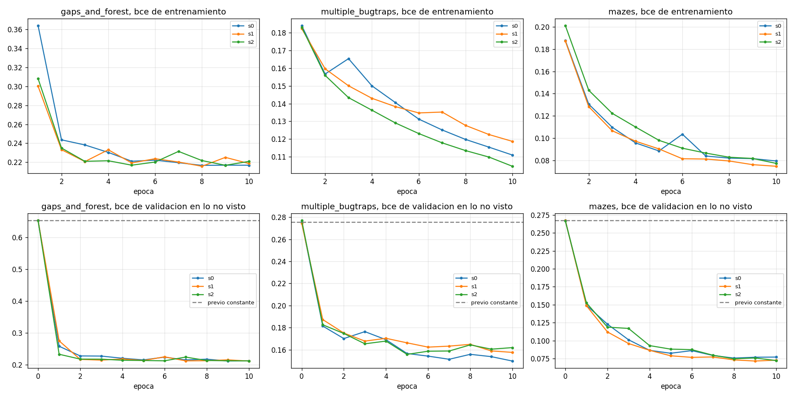
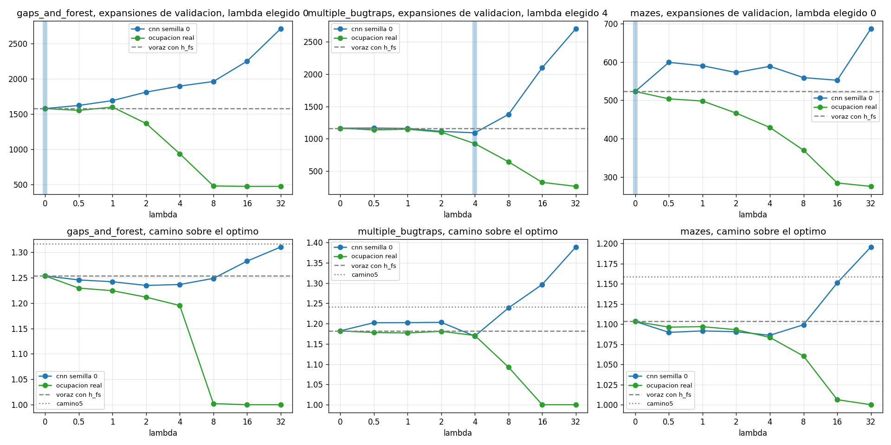
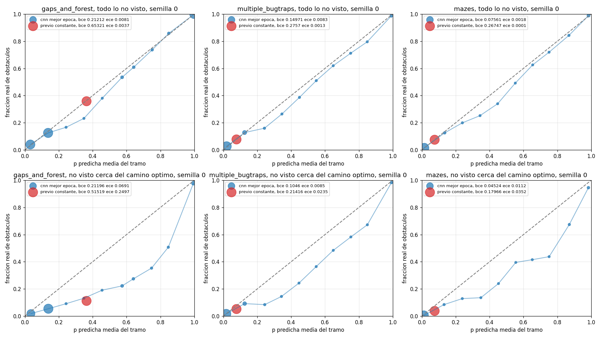
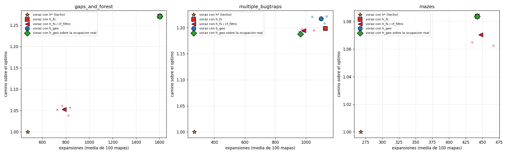

# Resumen de exp_geo
Carpeta tesis/code_v4, resultados en results\exp_geo. Borrador generado por resumen_geo.py, el RESUMEN.md a mano va aparte.

## Paso 1. La cnn de geometria contra el previo constante
| conjunto          | semilla | estrato  | celdas    | frac obst | bce previo | bce cnn | mejora bce % | auc cnn | ece previo | ece cnn | gana al previo |
|-------------------|---------|----------|-----------|-----------|------------|---------|--------------|---------|------------|---------|----------------|
| gaps_and_forest   | 0       | todo     | 124180278 | 0.36      | 0.6532     | 0.2121  | 67.5         | 0.9462  | 0.0037     | 0.0081  | 1              |
| gaps_and_forest   | 0       | corredor | 53356752  | 0.114     | 0.5152     | 0.212   | 58.9         | 0.8829  | 0.2497     | 0.0691  | 1              |
| gaps_and_forest   | 1       | todo     | 124091693 | 0.359     | 0.6531     | 0.2119  | 67.6         | 0.9457  | 0.0036     | 0.0036  | 1              |
| gaps_and_forest   | 1       | corredor | 53276053  | 0.113     | 0.5145     | 0.2106  | 59.1         | 0.8809  | 0.2503     | 0.066   | 1              |
| gaps_and_forest   | 2       | todo     | 124670756 | 0.359     | 0.6531     | 0.2123  | 67.5         | 0.9455  | 0.0037     | 0.0069  | 1              |
| gaps_and_forest   | 2       | corredor | 53560373  | 0.113     | 0.5145     | 0.2157  | 58.1         | 0.8805  | 0.2503     | 0.0732  | 1              |
| multiple_bugtraps | 0       | todo     | 123769945 | 0.079     | 0.2757     | 0.1497  | 45.7         | 0.9092  | 0.0013     | 0.0083  | 1              |
| multiple_bugtraps | 0       | corredor | 38641067  | 0.054     | 0.2142     | 0.1046  | 51.2         | 0.9253  | 0.0235     | 0.0085  | 1              |
| multiple_bugtraps | 1       | todo     | 118712078 | 0.078     | 0.2745     | 0.1576  | 42.6         | 0.8978  | 0.0009     | 0.0048  | 1              |
| multiple_bugtraps | 1       | corredor | 36534737  | 0.053     | 0.2118     | 0.1056  | 50.2         | 0.9206  | 0.0244     | 0.0094  | 1              |
| multiple_bugtraps | 2       | todo     | 121320109 | 0.079     | 0.2771     | 0.1557  | 43.8         | 0.9018  | 0.0016     | 0.002   | 1              |
| multiple_bugtraps | 2       | corredor | 37902779  | 0.053     | 0.2125     | 0.108   | 49.2         | 0.923   | 0.0246     | 0.0124  | 1              |
| mazes             | 0       | todo     | 60636664  | 0.075     | 0.2675     | 0.0756  | 71.7         | 0.9716  | 0.0001     | 0.0018  | 1              |
| mazes             | 0       | corredor | 19555098  | 0.04      | 0.1797     | 0.0452  | 74.8         | 0.9871  | 0.0352     | 0.0112  | 1              |
| mazes             | 1       | todo     | 59140320  | 0.075     | 0.2673     | 0.0715  | 73.2         | 0.9742  | 0.0001     | 0.0008  | 1              |
| mazes             | 1       | corredor | 19178639  | 0.04      | 0.1791     | 0.0438  | 75.6         | 0.9868  | 0.0353     | 0.012   | 1              |
| mazes             | 2       | todo     | 30376080  | 0.075     | 0.2666     | 0.0722  | 72.9         | 0.9753  | 0.0001     | 0.0015  | 1              |
| mazes             | 2       | corredor | 9952875   | 0.039     | 0.1771     | 0.0397  | 77.6         | 0.99    | 0.0357     | 0.0096  | 1              |
- gaps_and_forest. gana al previo en 3 de 3 semillas.
- multiple_bugtraps. gana al previo en 3 de 3 semillas.
- mazes. gana al previo en 3 de 3 semillas.

## Paso 2. Prueba, 100 mapas, relacion con la voraz con h_fs
| conjunto          | voraz con h* (techo) exp | voraz con h_fs exp | cf_filtro rel | geo rel | geo_real rel | cf_filtro camino vs h_fs % | geo camino vs h_fs % | geo_real camino vs h_fs % | h_geo por semilla | p h_geo |
|-------------------|--------------------------|--------------------|---------------|---------|--------------|----------------------------|----------------------|---------------------------|-------------------|---------|
| gaps_and_forest   | 474.0                    | 1604.0             | 0.488         | 1.0     | 1.0          | -17.2                      | 0.0                  | 0.0                       | 1.000 1.000 1.000 | 1.0     |
| multiple_bugtraps | 268.7                    | 1127.3             | 0.875         | 0.975   | 0.856        | -0.3                       | 1.6                  | -0.9                      | 1.007 0.996 0.923 | 0.1766  |
| mazes             | 267.7                    | 442.4              | 1.012         | 1.0     | 1.0          | -1.2                       | 0.0                  | 0.0                       | 1.000 1.000 1.000 | 1.0     |

Regla del paso 2. h_geo no pasa, 0 de 3. gaps_and_forest no pasa (mejora 0.0 %, p 1, camino +0.0 %, semillas < 1 en 0 de 3). multiple_bugtraps no pasa (mejora 2.5 %, p 0.177, camino +1.6 %, semillas < 1 en 2 de 3). mazes no pasa (mejora 0.0 %, p 1, camino +0.0 %, semillas < 1 en 0 de 3).

## Lambda elegido y base del paso 3
| conjunto          | h_fs exp | h_fs camino | lambda | h_geo exp | h_geo por semilla    | h_geo camino | h_geo rel | cf_filtro exp | cf_filtro por semilla | cf_filtro camino | cf_filtro rel | base elegida |
|-------------------|----------|-------------|--------|-----------|----------------------|--------------|-----------|---------------|-----------------------|------------------|---------------|--------------|
| gaps_and_forest   | 1579.2   | 1.253       | 0      | 1579.2    | 1579.2 1579.2 1579.2 | 1.253        | 1.0       | 826.9         | 822.5 823.2 835.1     | 1.05             | 0.524         | cf_filtro    |
| multiple_bugtraps | 1163.4   | 1.182       | 4      | 1085.4    | 1092.0 1127.1 1037.2 | 1.183        | 0.933     | 1025.3        | 1072.3 970.6 1032.9   | 1.189            | 0.881         | cf_filtro    |
| mazes             | 523.1    | 1.103       | 0      | 523.1     | 523.1 523.1 523.1    | 1.103        | 1.0       | 512.4         | 520.7 493.5 523.1     | 1.095            | 0.98          | cf_filtro    |

## Tiempos
| conjunto          | busqueda        | mapas | ms por nodo | ms red por nodo | s por mapa |
|-------------------|-----------------|-------|-------------|-----------------|------------|
| gaps_and_forest   | voraz_hfs       | 9     | 0.373       | 0.0             | 0.613      |
| gaps_and_forest   | cf_filtro_s0    | 9     | 3.448       | 3.218           | 2.606      |
| gaps_and_forest   | h_geo_lam4      | 9     | 3.153       | 2.806           | 6.384      |
| gaps_and_forest   | h_geo_real_lam4 | 9     | 0.277       | 0.0             | 0.285      |
| multiple_bugtraps | voraz_hfs       | 10    | 0.385       | 0.0             | 0.638      |
| multiple_bugtraps | cf_filtro_s0    | 10    | 4.651       | 4.301           | 7.224      |
| multiple_bugtraps | h_geo_lam4      | 10    | 3.531       | 3.145           | 6.895      |
| multiple_bugtraps | h_geo_real_lam4 | 10    | 0.291       | 0.0             | 0.398      |
| mazes             | voraz_hfs       | 10    | 0.391       | 0.0             | 0.16       |
| mazes             | cf_filtro_s0    | 10    | 4.013       | 3.705           | 1.636      |
| mazes             | h_geo_lam4      | 10    | 3.835       | 3.441           | 1.781      |
| mazes             | h_geo_real_lam4 | 10    | 0.349       | 0.0             | 0.121      |

## Figuras

Ocupacion predicha contra real en figuras/geo_<conjunto>.png.

## Que funciono

(pendiente de revisar)

## Que no funciono

(pendiente de revisar)

## Lo que necesita tu decision

(pendiente de revisar)
