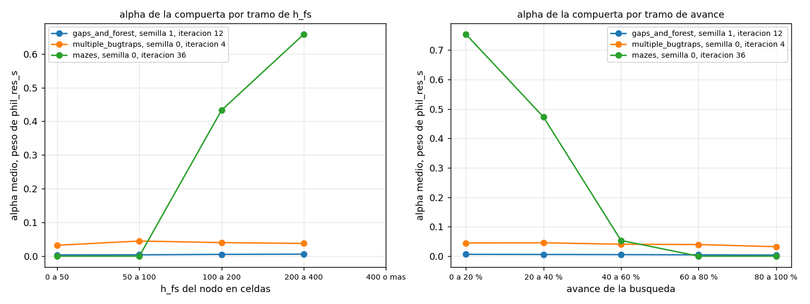
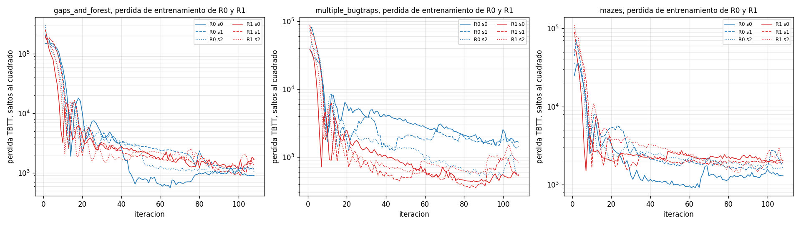
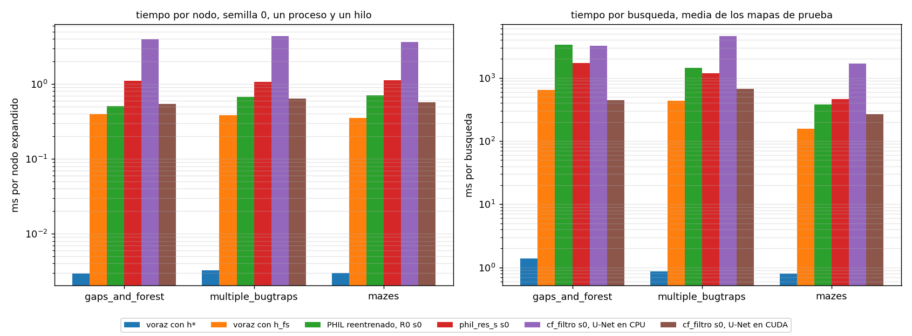
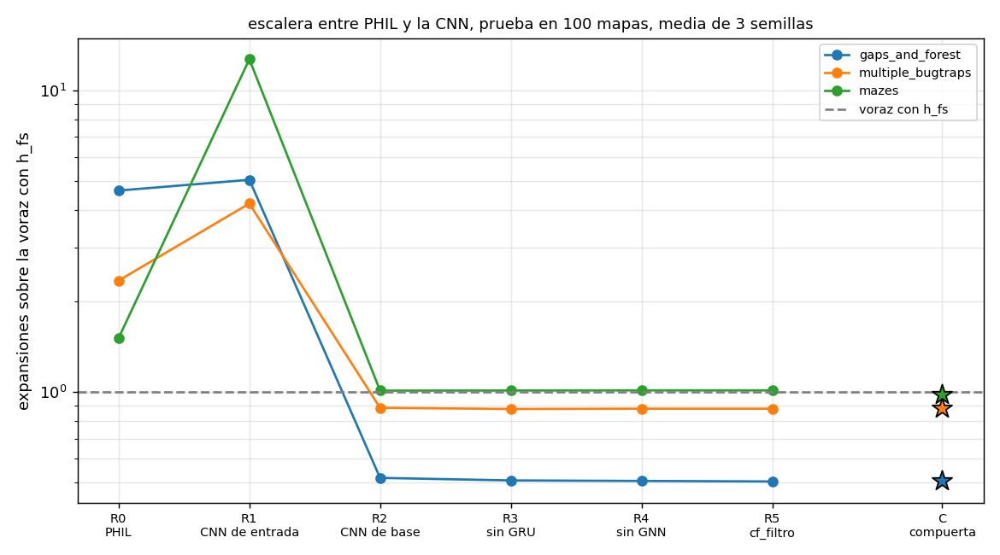

# Resumen de results/tesis. Cierre de exp_escalera sin entrenar nada

Carpeta tesis/code_v4, resultados en results/tesis. Escrito a mano a partir de tabla_principal.csv, camino.csv, mapas_comunes.csv, tabla_5_semillas.csv, comparaciones.csv, p_exp_cf2.csv, perdida_R0_R1.csv, perdida_R1_sobre_R0.csv, tiempos.csv, tiempos_sin_nucleo_fijo.csv, tiempos/nucleos.csv, tiempos/faltantes.csv y de results/exp_escalera/figuras/alpha_stats.csv y alpha_mapas.csv. Todo número sale de esos archivos. experiments/tesis.py arma las tablas y las figuras con los csv de prueba de code_v3 y de exp_escalera, y experiments/tiempos_limpios.py midió los tiempos. Las tablas completas están en tablas.md.

## En pocas líneas

- Entre las heurísticas de la tabla principal, cf_filtro es la mejor en gaps_and_forest y multiple_bugtraps, 0.505 y 0.88 de las expansiones de la voraz con h_fs con las semillas 0 a 2. En mazes la mejor es phil_res_s con 0.934 y cf_filtro queda en 1.012.
- R2 contra R0 pasa. PHIL con la CNN de base expande 0.112 y 0.379 de lo que expande PHIL solo en gaps_and_forest y multiple_bugtraps. En mazes baja a 0.669 pero con p 0.1427.
- cf_filtro contra PHIL viejo pasa, 0.111 y 0.476 en gaps_and_forest y multiple_bugtraps. phil_res_s contra cf_filtro no pasa, solo baja en mazes, 0.923.
- R1 aprende la regresión al mismo nivel que R0 y aun así busca mal. Al final del entrenamiento su pérdida va de 0.284 a 1.468 veces la de R0, y en mazes su validación en la iteración 108 es 15.84 y 16.647 veces la de R0 en las semillas 0 y 1.
- Con la semilla 1, iteración 12, la compuerta de gaps_and_forest queda casi cerrada, alpha medio 0.005.
- Con un solo proceso fijo en un núcleo de rendimiento, cf_filtro cuesta de 3.641 a 4.391 ms por nodo con la U-Net en CPU y de 0.54 a 0.639 con la U-Net en CUDA, contra 0.354 a 0.399 de la voraz con h_fs.
- El PHIL viejo de exp_cf no tiene best.pt en esta máquina, así que no tiene tiempo limpio. La Mac lo evaluó desde exp_cf/base/runs, que no vino en los tar, y en code_v3/results/exp_cf/phil solo están sus csv de prueba.
- El p 0.0018 de mazes en la tabla principal del RESUMEN de exp_cf2 es el de expansiones de cf_filtro contra la voraz con h_fs. El de camino da casi lo mismo por casualidad.

## Tabla principal, semillas 0 a 2

Prueba en los 100 mapas de cada conjunto, 91 resolubles en gaps_and_forest, tope de 10 000 expansiones. La relación es expansiones sobre las de la voraz con h_fs y p es el Wilcoxon pareado por mapa sobre la media de las semillas contra la voraz con h_fs. El camino es el largo sobre el óptimo en los mapas que resuelven todos los métodos con todas sus semillas. ms por nodo sale de los tiempos limpios de la semilla 0.

gaps_and_forest, camino en 89 de 91 mapas.

| búsqueda | semillas | expansiones | relación con h_fs | por semilla | éxito | camino sobre óptimo | p contra h_fs | ms por nodo |
|---|---|---|---|---|---|---|---|---|
| voraz con h* (techo) | 0 | 474.0 | 0.296 | 0.296 | 1.0 | 1.0 | < 0.0001 | 0.003 |
| voraz con h_fs | 0 | 1604.0 | 1.0 | 1.000 | 1.0 | 1.271 | | 0.399 |
| PHIL de exp_cf | 0 1 2 | 7319.4 | 4.563 | 4.127 4.681 4.882 | 0.993 | 1.512 | < 0.0001 | sin checkpoint |
| phil_res_s de exp_cf | 0 1 2 | 1571.2 | 0.98 | 0.973 0.980 0.986 | 1.0 | 1.267 | < 0.0001 | 1.098 |
| cf_filtro de exp_cf2 | 0 1 2 | 810.5 | 0.505 | 0.510 0.487 0.519 | 1.0 | 1.05 | < 0.0001 | 3.93 |

multiple_bugtraps, camino en 92 de 100 mapas.

| búsqueda | semillas | expansiones | relación con h_fs | por semilla | éxito | camino sobre óptimo | p contra h_fs | ms por nodo |
|---|---|---|---|---|---|---|---|---|
| voraz con h* (techo) | 0 | 268.7 | 0.238 | 0.238 | 1.0 | 1.0 | < 0.0001 | 0.003 |
| voraz con h_fs | 0 | 1127.3 | 1.0 | 1.000 | 1.0 | 1.161 | | 0.384 |
| PHIL de exp_cf | 0 1 2 | 2083.8 | 1.848 | 1.761 2.203 1.582 | 0.943 | 1.176 | < 0.0001 | sin checkpoint |
| phil_res_s de exp_cf | 0 1 2 | 1110.5 | 0.985 | 0.979 0.998 0.978 | 1.0 | 1.176 | < 0.0001 | 1.071 |
| cf_filtro de exp_cf2 | 0 1 2 | 992.3 | 0.88 | 0.932 0.862 0.847 | 1.0 | 1.157 | < 0.0001 | 4.391 |

mazes, camino en 100 de 100 mapas.

| búsqueda | semillas | expansiones | relación con h_fs | por semilla | éxito | camino sobre óptimo | p contra h_fs | ms por nodo |
|---|---|---|---|---|---|---|---|---|
| voraz con h* (techo) | 0 | 267.7 | 0.605 | 0.605 | 1.0 | 1.0 | < 0.0001 | 0.003 |
| voraz con h_fs | 0 | 442.4 | 1.0 | 1.000 | 1.0 | 1.084 | | 0.354 |
| PHIL de exp_cf | 0 1 2 | 417.2 | 0.943 | 0.941 0.777 1.111 | 1.0 | 1.099 | 0.3121 | sin checkpoint |
| phil_res_s de exp_cf | 0 1 2 | 413.2 | 0.934 | 0.922 0.959 0.921 | 1.0 | 1.061 | < 0.0001 | 1.128 |
| cf_filtro de exp_cf2 | 0 1 2 | 447.6 | 1.012 | 1.053 0.982 1.000 | 1.0 | 1.07 | 0.0018 | 3.641 |

Los mapas que quedan fuera del camino son los que pierde PHIL viejo, 2 pares semilla y mapa en 2 mapas de gaps_and_forest y 17 en 8 mapas de multiple_bugtraps. La media en los mapas propios de cada método, la que traían los RESUMEN anteriores, está en camino.csv. Cambia sobre todo en multiple_bugtraps, donde sin esos 8 mapas la voraz con h_fs baja de 1.198 a 1.161, phil_res_s de 1.212 a 1.176 y cf_filtro de 1.195 a 1.157. En gaps_and_forest cambia en el tercer decimal y en mazes no cambia.

## Cifras con 5 semillas

PHIL viejo tiene 5 semillas en los tres conjuntos y cf_filtro en gaps_and_forest y multiple_bugtraps. En mazes cf_filtro tiene solo las semillas 0 a 2. El camino de este bloque va en los mapas que resuelven la voraz con h* y con h_fs y todas las semillas de las filas del bloque en ese conjunto.

| conjunto | búsqueda | expansiones | relación con h_fs | por semilla | éxito | camino sobre óptimo | mapas del camino | p contra h_fs |
|---|---|---|---|---|---|---|---|---|
| gaps_and_forest | PHIL de exp_cf | 7049.4 | 4.395 | 4.127 4.681 4.882 3.960 4.325 | 0.98 | 1.479 | 84 | 1.19e-16 |
| gaps_and_forest | cf_filtro de exp_cf2 | 783.5 | 0.488 | 0.510 0.487 0.519 0.450 0.476 | 1.0 | 1.051 | 84 | 1.45e-16 |
| multiple_bugtraps | PHIL de exp_cf | 2185.9 | 1.939 | 1.761 2.203 1.582 2.209 1.942 | 0.942 | 1.165 | 90 | 1.95e-14 |
| multiple_bugtraps | cf_filtro de exp_cf2 | 986.4 | 0.875 | 0.932 0.862 0.847 0.870 0.865 | 1.0 | 1.157 | 90 | 2.6e-08 |
| mazes | PHIL de exp_cf | 446.6 | 1.01 | 0.941 0.777 1.111 1.194 1.024 | 1.0 | 1.086 | 100 | 0.00237 |

Con 5 semillas PHIL viejo pasa de 0.943 a 1.01 en mazes, porque las semillas 3 y 4 valen 1.194 y 1.024.

## Comparaciones nuevas

Formato de escalera.csv, criterio baja, que pide bajar más de 5 % con p menor que 0.05, las 3 semillas emparejadas por debajo de 1 y el camino no más de 5 % peor, en 2 de 3 conjuntos.

| a | b | conjunto | a sobre b | p | a sobre b por semilla | semillas menores que 1 | camino a sobre b | pasa |
|---|---|---|---|---|---|---|---|---|
| R2 | R0 | gaps_and_forest | 0.112 | 0.0 | 0.127 0.118 0.095 | 3 de 3 | 0.671 | sí |
| R2 | R0 | multiple_bugtraps | 0.379 | 0.0 | 0.517 0.441 0.259 | 3 de 3 | 0.931 | sí |
| R2 | R0 | mazes | 0.669 | 0.1427 | 0.865 0.903 0.449 | 3 de 3 | 1.008 | no |
| phil_res_s | cf_filtro | gaps_and_forest | 1.938 | 0.0 | 1.908 2.013 1.898 | 0 de 3 | 1.208 | no |
| phil_res_s | cf_filtro | multiple_bugtraps | 1.119 | 0.0 | 1.051 1.157 1.156 | 0 de 3 | 1.014 | no |
| phil_res_s | cf_filtro | mazes | 0.923 | 0.0 | 0.875 0.977 0.921 | 3 de 3 | 0.991 | sí |
| cf_filtro | PHIL viejo | gaps_and_forest | 0.111 | 0.0 | 0.124 0.104 0.106 | 3 de 3 | 0.694 | sí |
| cf_filtro | PHIL viejo | multiple_bugtraps | 0.476 | 0.0 | 0.529 0.392 0.535 | 3 de 3 | 0.984 | sí |
| cf_filtro | PHIL viejo | mazes | 1.073 | 0.1083 | 1.120 1.263 0.900 | 1 de 3 | 0.974 | no |

- R2 contra R0 pasa en 2 de 3 conjuntos. En mazes las 3 semillas quedan por debajo de 1 pero el Wilcoxon no alcanza. Ojo al leerlo, en 3 de las 9 corridas R2 quedó en su iteración 0, que es cf_filtro, gaps_and_forest semilla 2 y mazes semillas 0 y 2, y R0 de gaps_and_forest semilla 2 eligió su iteración 0, sin entrenar. Ahí la comparación es la base sola contra PHIL o PHIL con base contra PHIL sin entrenar.
- phil_res_s contra cf_filtro no pasa, baja solo en mazes.
- cf_filtro contra PHIL viejo pasa en 2 de 3 conjuntos. En mazes queda 7.3 % peor con p 0.1083.

## alpha de la compuerta

La semilla 0 de C en gaps_and_forest quedó en la iteración 0, donde la última capa de la compuerta está en cero y alpha es 0 en todos los nodos por construcción, así que no dice nada de lo que aprendió. Con la semilla 1, iteración 12, la compuerta está abierta en todos los nodos pero casi cerrada, alpha medio 0.005, entre 0.0036 y 0.0061 según el tramo de h_fs o de avance, contado en llamadas a la red, y máximo 0.0077 en los 9 mapas. En prueba esa semilla quedó 1.020 veces cf_filtro. multiple_bugtraps y mazes siguen con la semilla 0 y no cambian, alpha medio 0.0403 y 0.2503, con 0.7535 en el primer 20 % de la búsqueda de mazes. El mapa de alpha de gaps_and_forest con la semilla 1 está en results/exp_escalera/figuras/alpha_gaps_and_forest.png.

## Pérdida de R0 y R1

La pérdida de train.csv es la TBTT contra h* sobre todas las trayectorias acumuladas hasta cada iteración, en saltos al cuadrado. La media de las iteraciones 97 a 108 va de 718.8 a 2064.5 en R0 y de 523.3 a 2254.2 en R1 según conjunto y semilla, o sea un error cuadrático medio de 26.8 a 45.4 celdas en R0 y de 22.9 a 47.5 en R1. Esa media de R1 sobre la de R0 va de 0.284 a 1.468, y en 4 de las 9 parejas R1 queda más bajo. En la iteración 108 de validación los dos están igual de mal en gaps_and_forest y multiple_bugtraps, entre 8457.9 y 10 000 expansiones, con R1 sobre R0 entre 0.984 y 1.182. En mazes R0 llega a 631.3 y 600.7 en las semillas 0 y 1 y R1 a 10 000, 15.84 y 16.647 veces más.

R1 aprende la regresión al mismo nivel que R0 y aun así busca mal. Dos cuidados al leerlo. La pérdida se mide sobre las trayectorias que cada modelo juntó con su propio roll-in, no sobre un conjunto común. Y un error de 22.9 a 47.5 celdas es grande para una búsqueda voraz, que decide por el orden entre vecinos que difieren en una celda de h*, así que esta pérdida no mide lo que importa para buscar.

## Tiempos limpios

Semilla 0, los mapas de prueba de cada conjunto, un solo proceso con un hilo de torch, un método detrás del otro con el mismo código de la prueba, 2 mapas de calentamiento por método. El proceso quedó fijo en el núcleo lógico 4. De los núcleos lógicos probados, en el 0, 2, 4 y 10 la U-Net cuesta entre 70.0 y 78.8 ms por llamada, y en el 12, 14, 16 y 19, que son de eficiencia en el i7-12700H, entre 174.7 y 176.8. La primera medición, sin fijar el núcleo, quedó en tiempos_sin_nucleo_fijo.csv y no se usa, porque windows movió el proceso entre los dos tipos y la llamada a la U-Net costó 72.1 ms en gaps_and_forest y 108.0 y 102.4 en los otros dos.

| búsqueda | gaps_and_forest ms por nodo | ms por búsqueda | multiple_bugtraps ms por nodo | ms por búsqueda | mazes ms por nodo | ms por búsqueda |
|---|---|---|---|---|---|---|
| voraz con h* | 0.003 | 1.4 | 0.003 | 0.9 | 0.003 | 0.8 |
| voraz con h_fs | 0.399 | 639.6 | 0.384 | 433.2 | 0.354 | 156.8 |
| PHIL reentrenado, R0 s0 | 0.507 | 3334.0 | 0.675 | 1450.1 | 0.705 | 380.0 |
| phil_res_s s0 | 1.098 | 1713.2 | 1.071 | 1174.7 | 1.128 | 460.1 |
| cf_filtro s0, U-Net en CPU | 3.93 | 3214.2 | 4.391 | 4611.8 | 3.641 | 1696.9 |
| cf_filtro s0, U-Net en CUDA | 0.54 | 442.7 | 0.639 | 669.1 | 0.571 | 266.1 |

- cf_filtro expande la mitad que la voraz con h_fs en gaps_and_forest, pero con la U-Net en CPU cada búsqueda tarda 3214.2 ms contra 639.6. Con la U-Net en CUDA tarda 442.7, menos que la voraz con h_fs. En multiple_bugtraps y mazes, aun con CUDA, tarda más, 669.1 y 266.1 contra 433.2 y 156.8.
- La U-Net en CPU cuesta de 66.4 a 81.4 ms por llamada según el conjunto, y en CUDA de 5.2 a 6.0.
- Las expansiones de la medición repiten las de la prueba en todos los mapas en la voraz con h* y con h_fs y en R0. cf_filtro con la U-Net en CPU repite las de la Mac en 89 de 91, 100 de 100 y 100 de 100 mapas, y con la U-Net en CUDA en 69 de 91, 78 de 100 y 94 de 100. phil_res_s las repite en 78 de 91, 54 de 100 y 100 de 100.
- PHIL viejo no se pudo medir porque no tiene best.pt acá. R0 s0 es la misma clase PHIL reentrenada en exp_escalera y sirve de referencia para su costo por nodo, 0.507 a 0.705 ms. Su costo por búsqueda no sirve para el PHIL viejo porque expande distinto.
- Las cifras dependen del núcleo y del momento. En nucleos.csv los cuatro núcleos de rendimiento probados van de 70.0 a 78.8 ms por llamada a la U-Net, 13 % de punta a punta. En gaps_and_forest, el primer conjunto que se midió, la medición fija salió entre 13 y 29 % más lenta que la primera en la voraz con h_fs, R0 y phil_res_s. Diferencias de ese orden entre métodos no son claras.

## El p 0.0018 de mazes en el RESUMEN de exp_cf2

Es el Wilcoxon pareado por mapa de las expansiones de cf_filtro, media de sus semillas 0 a 2, contra la voraz con h_fs. Da 0.001838, con 447.6 expansiones contra 442.4, o sea cf_filtro expande 1.2 % más. La columna p de esa tabla es de expansiones, porque las celdas que separan las dos lecturas coinciden solo con el p de expansiones y ninguna coincide solo con el de camino. Las que más pesan son PHIL en mazes, que dice 0.0024, con 0.00237 de expansiones y 0.757 de camino, y cf_filtro en multiple_bugtraps, que dice 3e-08, con 2.595e-08 de expansiones y 0.0006566 de camino. PHIL en gaps_and_forest también coincide solo con expansiones, 1.192e-16 contra 1.711e-15 de camino, pero ahí el 1e-16 puede ser una marca de valor muy chico, como en las celdas que no se reproducen. El p del camino de cf_filtro en mazes, 1.07 contra 1.084, da 0.001805 y también redondea a 0.0018, así que la decisión 3 de ese RESUMEN, reportar mazes por camino con p 0.0018, acierta el número. Ese p es frágil, porque 47 de los 100 mapas empatan en camino con h_fs y el Wilcoxon por defecto los descarta, y con el tratamiento de Pratt, que los cuenta, da 0.0875. Y las expansiones no son un empate con h_fs, cf_filtro expande 1.2 % más con p 0.0018. Las celdas que dicen 1e-16 en PHIL multiple_bugtraps y en las tres de phil_res_s no se reproducen, ahí el p de expansiones va de 1.95e-14 a 4.027e-08, igual de chico para cualquier conclusión.

## La escalera

La misma figura de exp_escalera, leída de su resumen.csv.

## Lo que necesita tu decisión

1. El tiempo del PHIL viejo. Para medirlo hacen falta los best.pt de la semilla 0 que exp_cf evaluó en la Mac, results/exp_cf/base/runs/<conjunto>/phil_s_s0/best.pt, copiados a la misma ruta bajo code_v3. Con eso se corre experiments/tiempos_limpios.py con --nucleo 4 --metodos phil_viejo_s0, que mide solo el PHIL viejo y no toca los demás tiempos, y después experiments/tesis.py, que llena la celda de tabla_principal.csv y de tablas.md. La tabla de este RESUMEN se corrige a mano. Mientras tanto la tabla puede citar a R0 como la misma arquitectura.
2. Con qué semillas va PHIL viejo en la tabla. Con 0 a 2 vale 0.943 en mazes y con 5 semillas 1.01. La tabla principal usa 0 a 2 como pediste y las 5 van aparte.
