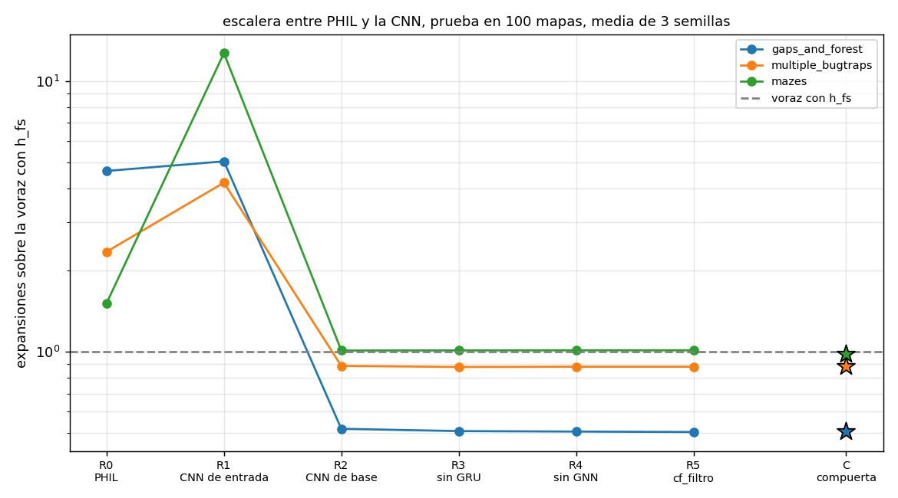
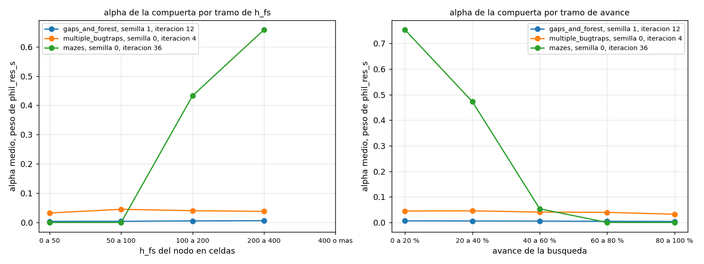
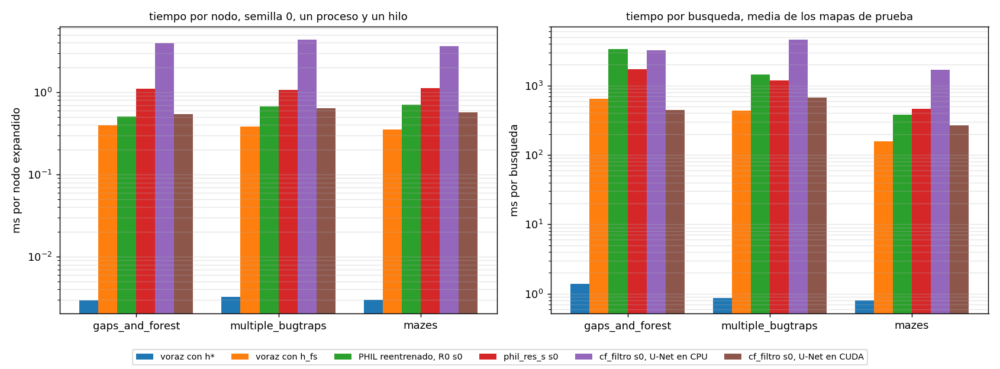
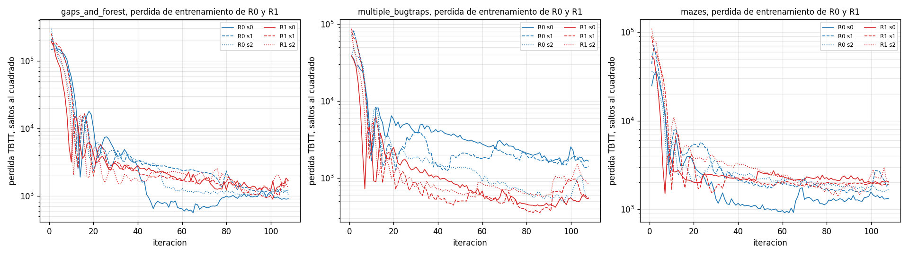

# Tablas de la tesis
Generadas por experiments/tesis.py a partir de los csv. Prueba en los 100 mapas de cada conjunto, 91 resolubles en gaps_and_forest, tope de 10 000 expansiones. Relacion es expansiones sobre las de la voraz con h_fs. Wilcoxon pareado por mapa sobre la media de las semillas. ms por nodo de los tiempos limpios, semilla 0, un proceso y un hilo, red en CPU como en la prueba.

## Tabla principal, semillas 0 a 2

### gaps_and_forest, camino en los 89 de 91 mapas que resuelven todos los metodos y semillas

| busqueda             | semillas | expansiones | relacion con h_fs | por semilla       | exito | camino sobre optimo, mapas comunes | p contra h_fs | ms por nodo    |
|----------------------|----------|-------------|-------------------|-------------------|-------|------------------------------------|---------------|----------------|
| voraz con h* (techo) | 0        | 474.0       | 0.296             | 0.296             | 1.0   | 1.0                                | < 0.0001      | 0.003          |
| voraz con h_fs       | 0        | 1604.0      | 1.0               | 1.000             | 1.0   | 1.271                              |               | 0.399          |
| PHIL de exp_cf       | 0 1 2    | 7319.4      | 4.563             | 4.127 4.681 4.882 | 0.993 | 1.512                              | < 0.0001      | sin checkpoint |
| phil_res_s de exp_cf | 0 1 2    | 1571.2      | 0.98              | 0.973 0.980 0.986 | 1.0   | 1.267                              | < 0.0001      | 1.098          |
| cf_filtro de exp_cf2 | 0 1 2    | 810.5       | 0.505             | 0.510 0.487 0.519 | 1.0   | 1.05                               | < 0.0001      | 3.93           |

### multiple_bugtraps, camino en los 92 de 100 mapas que resuelven todos los metodos y semillas

| busqueda             | semillas | expansiones | relacion con h_fs | por semilla       | exito | camino sobre optimo, mapas comunes | p contra h_fs | ms por nodo    |
|----------------------|----------|-------------|-------------------|-------------------|-------|------------------------------------|---------------|----------------|
| voraz con h* (techo) | 0        | 268.7       | 0.238             | 0.238             | 1.0   | 1.0                                | < 0.0001      | 0.003          |
| voraz con h_fs       | 0        | 1127.3      | 1.0               | 1.000             | 1.0   | 1.161                              |               | 0.384          |
| PHIL de exp_cf       | 0 1 2    | 2083.8      | 1.848             | 1.761 2.203 1.582 | 0.943 | 1.176                              | < 0.0001      | sin checkpoint |
| phil_res_s de exp_cf | 0 1 2    | 1110.5      | 0.985             | 0.979 0.998 0.978 | 1.0   | 1.176                              | < 0.0001      | 1.071          |
| cf_filtro de exp_cf2 | 0 1 2    | 992.3       | 0.88              | 0.932 0.862 0.847 | 1.0   | 1.157                              | < 0.0001      | 4.391          |

### mazes, camino en los 100 de 100 mapas que resuelven todos los metodos y semillas

| busqueda             | semillas | expansiones | relacion con h_fs | por semilla       | exito | camino sobre optimo, mapas comunes | p contra h_fs | ms por nodo    |
|----------------------|----------|-------------|-------------------|-------------------|-------|------------------------------------|---------------|----------------|
| voraz con h* (techo) | 0        | 267.7       | 0.605             | 0.605             | 1.0   | 1.0                                | < 0.0001      | 0.003          |
| voraz con h_fs       | 0        | 442.4       | 1.0               | 1.000             | 1.0   | 1.084                              |               | 0.354          |
| PHIL de exp_cf       | 0 1 2    | 417.2       | 0.943             | 0.941 0.777 1.111 | 1.0   | 1.099                              | 0.3121        | sin checkpoint |
| phil_res_s de exp_cf | 0 1 2    | 413.2       | 0.934             | 0.922 0.959 0.921 | 1.0   | 1.061                              | < 0.0001      | 1.128          |
| cf_filtro de exp_cf2 | 0 1 2    | 447.6       | 1.012             | 1.053 0.982 1.000 | 1.0   | 1.07                               | 0.0018        | 3.641          |

## Camino en mapas comunes y en mapas propios

| conjunto          | busqueda             | semillas | camino en mapas comunes | mapas comunes | camino en mapas propios | exito |
|-------------------|----------------------|----------|-------------------------|---------------|-------------------------|-------|
| gaps_and_forest   | voraz con h* (techo) | 0        | 1.0                     | 89            | 1.0                     | 1.0   |
| gaps_and_forest   | voraz con h_fs       | 0        | 1.271                   | 89            | 1.271                   | 1.0   |
| gaps_and_forest   | PHIL de exp_cf       | 0 1 2    | 1.512                   | 89            | 1.513                   | 0.993 |
| gaps_and_forest   | phil_res_s de exp_cf | 0 1 2    | 1.267                   | 89            | 1.269                   | 1.0   |
| gaps_and_forest   | cf_filtro de exp_cf2 | 0 1 2    | 1.05                    | 89            | 1.05                    | 1.0   |
| multiple_bugtraps | voraz con h* (techo) | 0        | 1.0                     | 92            | 1.0                     | 1.0   |
| multiple_bugtraps | voraz con h_fs       | 0        | 1.161                   | 92            | 1.198                   | 1.0   |
| multiple_bugtraps | PHIL de exp_cf       | 0 1 2    | 1.176                   | 92            | 1.178                   | 0.943 |
| multiple_bugtraps | phil_res_s de exp_cf | 0 1 2    | 1.176                   | 92            | 1.212                   | 1.0   |
| multiple_bugtraps | cf_filtro de exp_cf2 | 0 1 2    | 1.157                   | 92            | 1.195                   | 1.0   |
| mazes             | voraz con h* (techo) | 0        | 1.0                     | 100           | 1.0                     | 1.0   |
| mazes             | voraz con h_fs       | 0        | 1.084                   | 100           | 1.084                   | 1.0   |
| mazes             | PHIL de exp_cf       | 0 1 2    | 1.099                   | 100           | 1.099                   | 1.0   |
| mazes             | phil_res_s de exp_cf | 0 1 2    | 1.061                   | 100           | 1.061                   | 1.0   |
| mazes             | cf_filtro de exp_cf2 | 0 1 2    | 1.07                    | 100           | 1.07                    | 1.0   |

## Mapas que quedan fuera del camino comun

| conjunto          | mapas resolubles | mapas comunes | mapas fuera | quien pierde mapas                                |
|-------------------|------------------|---------------|-------------|---------------------------------------------------|
| gaps_and_forest   | 91               | 89            | 2           | PHIL de exp_cf 2 pares semilla y mapa en 2 mapas  |
| multiple_bugtraps | 100              | 92            | 8           | PHIL de exp_cf 17 pares semilla y mapa en 8 mapas |
| mazes             | 100              | 100           | 0           | nadie                                             |

## Cifras con 5 semillas, donde existen

| conjunto          | busqueda             | semillas  | mapas | expansiones | relacion con h_fs | por semilla                   | exito | camino en mapas comunes del bloque | mapas comunes del bloque | camino en mapas propios | p contra h_fs |
|-------------------|----------------------|-----------|-------|-------------|-------------------|-------------------------------|-------|------------------------------------|--------------------------|-------------------------|---------------|
| gaps_and_forest   | PHIL de exp_cf       | 0 1 2 3 4 | 91    | 7049.4      | 4.395             | 4.127 4.681 4.882 3.960 4.325 | 0.98  | 1.479                              | 84                       | 1.482                   | 1.19e-16      |
| gaps_and_forest   | cf_filtro de exp_cf2 | 0 1 2 3 4 | 91    | 783.5       | 0.488             | 0.510 0.487 0.519 0.450 0.476 | 1.0   | 1.051                              | 84                       | 1.053                   | 1.45e-16      |
| multiple_bugtraps | PHIL de exp_cf       | 0 1 2 3 4 | 100   | 2185.9      | 1.939             | 1.761 2.203 1.582 2.209 1.942 | 0.942 | 1.165                              | 90                       | 1.174                   | 1.95e-14      |
| multiple_bugtraps | cf_filtro de exp_cf2 | 0 1 2 3 4 | 100   | 986.4       | 0.875             | 0.932 0.862 0.847 0.870 0.865 | 1.0   | 1.157                              | 90                       | 1.194                   | 2.6e-08       |
| mazes             | PHIL de exp_cf       | 0 1 2 3 4 | 100   | 446.6       | 1.01              | 0.941 0.777 1.111 1.194 1.024 | 1.0   | 1.086                              | 100                      | 1.086                   | 0.00237       |

## Comparaciones nuevas, criterio baja, semillas 0 a 2 emparejadas

| a          | b          | conjunto          | criterio | mapas | exp a  | exp b  | a sobre b | mejora % | p Wilcoxon | mapas donde gana a | a sobre b por semilla | semillas < 1 | camino a sobre b | pasa en el conjunto |
|------------|------------|-------------------|----------|-------|--------|--------|-----------|----------|------------|--------------------|-----------------------|--------------|------------------|---------------------|
| R2         | R0         | gaps_and_forest   | baja     | 91    | 832.7  | 7456.5 | 0.112     | 88.8     | 0.0        | 91                 | 0.127 0.118 0.095     | 3 de 3       | 0.671            | 1                   |
| R2         | R0         | multiple_bugtraps | baja     | 100   | 998.9  | 2636.9 | 0.379     | 62.1     | 0.0        | 100                | 0.517 0.441 0.259     | 3 de 3       | 0.931            | 1                   |
| R2         | R0         | mazes             | baja     | 100   | 446.8  | 667.4  | 0.669     | 33.1     | 0.1427     | 43                 | 0.865 0.903 0.449     | 3 de 3       | 1.008            | 0                   |
| phil_res_s | cf_filtro  | gaps_and_forest   | baja     | 91    | 1571.2 | 810.5  | 1.938     | -93.8    | 0.0        | 1                  | 1.908 2.013 1.898     | 0 de 3       | 1.208            | 0                   |
| phil_res_s | cf_filtro  | multiple_bugtraps | baja     | 100   | 1110.5 | 992.3  | 1.119     | -11.9    | 0.0        | 29                 | 1.051 1.157 1.156     | 0 de 3       | 1.014            | 0                   |
| phil_res_s | cf_filtro  | mazes             | baja     | 100   | 413.2  | 447.6  | 0.923     | 7.7      | 0.0        | 84                 | 0.875 0.977 0.921     | 3 de 3       | 0.991            | 1                   |
| cf_filtro  | PHIL viejo | gaps_and_forest   | baja     | 91    | 810.5  | 7319.4 | 0.111     | 88.9     | 0.0        | 91                 | 0.124 0.104 0.106     | 3 de 3       | 0.694            | 1                   |
| cf_filtro  | PHIL viejo | multiple_bugtraps | baja     | 100   | 992.3  | 2083.8 | 0.476     | 52.4     | 0.0        | 73                 | 0.529 0.392 0.535     | 3 de 3       | 0.984            | 1                   |
| cf_filtro  | PHIL viejo | mazes             | baja     | 100   | 447.6  | 417.2  | 1.073     | -7.3     | 0.1083     | 43                 | 1.120 1.263 0.900     | 1 de 3       | 0.974            | 0                   |

- R2 contra R0, PHIL con la CNN de base baja a PHIL solo. pasa, baja mas de 5 % con Wilcoxon y 3 de 3 semillas en 2 de 3 conjuntos.
- phil_res_s contra cf_filtro, phil_res_s baja a cf_filtro. no pasa, baja mas de 5 % con Wilcoxon y 3 de 3 semillas en 1 de 3 conjuntos.
- cf_filtro contra PHIL viejo, cf_filtro baja a PHIL viejo. pasa, baja mas de 5 % con Wilcoxon y 3 de 3 semillas en 2 de 3 conjuntos.

## El p 0.0018 de mazes en el RESUMEN de exp_cf2

Cada celda p de la tabla principal de ese RESUMEN contra el Wilcoxon de expansiones y el de camino de resumen_cf.py, con sus mismas semillas.

| modelo     | conjunto          | semillas  | p en el RESUMEN de exp_cf2 | p de expansiones | p de camino | coincide con         | relacion con h_fs | expansiones | expansiones voraz con h_fs | camino | camino voraz con h_fs | mapas del p de camino | mapas con el camino empatado | p de camino con pratt |
|------------|-------------------|-----------|----------------------------|------------------|-------------|----------------------|-------------------|-------------|----------------------------|--------|-----------------------|-----------------------|------------------------------|-----------------------|
| PHIL       | gaps_and_forest   | 0 1 2 3 4 | 1e-16                      | 1.192e-16        | 1.711e-15   | expansiones          | 4.395             | 7049.4      | 1604.0                     | 1.482  | 1.268                 | 84                    | 0                            | 1.711e-15             |
| PHIL       | multiple_bugtraps | 0 1 2 3 4 | 1e-16                      | 1.95e-14         | 0.01909     | ninguno              | 1.939             | 2185.9      | 1127.3                     | 1.174  | 1.16                  | 90                    | 0                            | 0.01909               |
| PHIL       | mazes             | 0 1 2 3 4 | 0.0024                     | 0.00237          | 0.757       | expansiones          | 1.01              | 446.6       | 442.4                      | 1.086  | 1.084                 | 100                   | 0                            | 0.757                 |
| phil_res_s | gaps_and_forest   | 0 1 2     | 1e-16                      | 4.027e-08        | 0.5291      | ninguno              | 0.98              | 1571.2      | 1604.0                     | 1.269  | 1.271                 | 91                    | 0                            | 0.5291                |
| phil_res_s | multiple_bugtraps | 0 1 2     | 1e-16                      | 1.648e-10        | 2.521e-06   | ninguno              | 0.985             | 1110.5      | 1127.3                     | 1.212  | 1.198                 | 100                   | 13                           | 4.22e-07              |
| phil_res_s | mazes             | 0 1 2     | 1e-16                      | 2.4e-12          | 1.474e-05   | ninguno              | 0.934             | 413.2       | 442.4                      | 1.061  | 1.084                 | 100                   | 58                           | 0.00388               |
| cf_filtro  | gaps_and_forest   | 0 1 2 3 4 | 1e-16                      | 1.455e-16        | 1.192e-16   | expansiones y camino | 0.488             | 783.5       | 1604.0                     | 1.053  | 1.271                 | 91                    | 0                            | 1.192e-16             |
| cf_filtro  | multiple_bugtraps | 0 1 2 3 4 | 3e-08                      | 2.595e-08        | 0.0006566   | expansiones          | 0.875             | 986.4       | 1127.3                     | 1.194  | 1.198                 | 100                   | 13                           | 5.195e-05             |
| cf_filtro  | mazes             | 0 1 2     | 0.0018                     | 0.001838         | 0.001805    | expansiones y camino | 1.012             | 447.6       | 442.4                      | 1.07   | 1.084                 | 100                   | 47                           | 0.0875                |

## Perdida de entrenamiento de R0 y R1

Perdida TBTT contra h* sobre todas las trayectorias acumuladas en la iteracion, en saltos al cuadrado, de train.csv.

| conjunto          | peldano | semilla | perdida iteracion 1 | media iteraciones 1 a 12 | media iteraciones 97 a 108 | raiz de la media 97 a 108 en celdas | minima | iteracion de la minima | iteracion elegida | perdida en la elegida | validacion en la elegida | validacion en la 108 | val h_fs |
|-------------------|---------|---------|---------------------|--------------------------|----------------------------|-------------------------------------|--------|------------------------|-------------------|-----------------------|--------------------------|----------------------|----------|
| gaps_and_forest   | R0      | 0       | 146480.1            | 107543.1                 | 979.8                      | 31.3                                | 563.6  | 65                     | 8                 | 104422.4              | 6602.8                   | 10000.0              | 1579.2   |
| gaps_and_forest   | R1      | 0       | 189526.6            | 64577.1                  | 1438.6                     | 37.9                                | 1162.1 | 102                    | 20                | 4101.2                | 9753.3                   | 10000.0              | 1579.2   |
| gaps_and_forest   | R0      | 1       | 209301.2            | 106086.5                 | 1194.6                     | 34.6                                | 1154.7 | 103                    | 4                 | 138116.7              | 7178.4                   | 10000.0              | 1579.2   |
| gaps_and_forest   | R1      | 1       | 252411.3            | 114414.9                 | 1190.8                     | 34.5                                | 895.1  | 101                    | 48                | 1890.9                | 7688.9                   | 10000.0              | 1579.2   |
| gaps_and_forest   | R0      | 2       | 299022.6            | 93615.8                  | 1127.8                     | 33.6                                | 1020.0 | 97                     | 0                 |                       | 8903.5                   | 9596.9               | 1579.2   |
| gaps_and_forest   | R1      | 2       | 195944.5            | 81883.3                  | 1539.8                     | 39.2                                | 1159.5 | 93                     | 4                 | 127113.2              | 6475.5                   | 10000.0              | 1579.2   |
| multiple_bugtraps | R0      | 0       | 38352.5             | 18828.4                  | 1842.7                     | 42.9                                | 1472.9 | 96                     | 16                | 3548.8                | 2180.0                   | 8791.6               | 1163.4   |
| multiple_bugtraps | R1      | 0       | 38783.8             | 11772.0                  | 523.3                      | 22.9                                | 415.4  | 93                     | 36                | 1055.8                | 5162.6                   | 8649.6               | 1163.4   |
| multiple_bugtraps | R0      | 1       | 69152.6             | 30379.2                  | 1627.8                     | 40.3                                | 1233.5 | 44                     | 24                | 2569.0                | 2116.5                   | 8457.9               | 1163.4   |
| multiple_bugtraps | R1      | 1       | 87098.7             | 29883.4                  | 781.2                      | 27.9                                | 352.6  | 86                     | 20                | 1073.7                | 4168.2                   | 10000.0              | 1163.4   |
| multiple_bugtraps | R0      | 2       | 37650.8             | 23193.6                  | 718.8                      | 26.8                                | 479.0  | 97                     | 4                 | 37628.3               | 3357.3                   | 10000.0              | 1163.4   |
| multiple_bugtraps | R1      | 2       | 79263.4             | 20545.3                  | 1053.5                     | 32.5                                | 556.1  | 57                     | 8                 | 1841.3                | 4846.2                   | 10000.0              | 1163.4   |
| mazes             | R0      | 0       | 24907.3             | 16487.1                  | 1381.0                     | 37.2                                | 909.2  | 61                     | 108               | 1312.9                | 631.3                    | 631.3                | 523.1    |
| mazes             | R1      | 0       | 53750.1             | 15845.5                  | 2014.9                     | 44.9                                | 1501.4 | 7                      | 4                 | 20540.5               | 5659.9                   | 10000.0              | 523.1    |
| mazes             | R0      | 1       | 44131.6             | 24434.6                  | 2064.5                     | 45.4                                | 1530.2 | 89                     | 72                | 1731.4                | 550.0                    | 600.7                | 523.1    |
| mazes             | R1      | 1       | 90717.1             | 31771.5                  | 1915.3                     | 43.8                                | 1543.1 | 28                     | 4                 | 47350.1               | 9033.8                   | 10000.0              | 523.1    |
| mazes             | R0      | 2       | 36098.2             | 15258.2                  | 1692.3                     | 41.1                                | 1586.0 | 106                    | 20                | 2045.1                | 1194.3                   | 9981.9               | 523.1    |
| mazes             | R1      | 2       | 109979.7            | 36351.4                  | 2254.2                     | 47.5                                | 1402.6 | 85                     | 24                | 3717.5                | 1947.1                   | 9536.4               | 523.1    |

| conjunto          | semilla | perdida R1 sobre R0, iteraciones 1 a 12 | perdida R1 sobre R0, iteraciones 97 a 108 | validacion R1 sobre R0 en la 108 |
|-------------------|---------|-----------------------------------------|-------------------------------------------|----------------------------------|
| gaps_and_forest   | 0       | 0.6                                     | 1.468                                     | 1.0                              |
| gaps_and_forest   | 1       | 1.079                                   | 0.997                                     | 1.0                              |
| gaps_and_forest   | 2       | 0.875                                   | 1.365                                     | 1.042                            |
| multiple_bugtraps | 0       | 0.625                                   | 0.284                                     | 0.984                            |
| multiple_bugtraps | 1       | 0.984                                   | 0.48                                      | 1.182                            |
| multiple_bugtraps | 2       | 0.886                                   | 1.466                                     | 1.0                              |
| mazes             | 0       | 0.961                                   | 1.459                                     | 15.84                            |
| mazes             | 1       | 1.3                                     | 0.928                                     | 16.647                           |
| mazes             | 2       | 2.382                                   | 1.332                                     | 0.955                            |

## Tiempos limpios, semilla 0, proceso fijo en un nucleo de rendimiento

| conjunto          | busqueda                    | dispositivo | mapas | encontrados | expansiones | ms por nodo | ms por busqueda | ms por llamada a la U-Net | mapas con las mismas expansiones que la prueba |
|-------------------|-----------------------------|-------------|-------|-------------|-------------|-------------|-----------------|---------------------------|------------------------------------------------|
| gaps_and_forest   | voraz con h*                | cpu         | 91    | 91          | 474.0       | 0.003       | 1.4             |                           | 91 de 91                                       |
| gaps_and_forest   | voraz con h_fs              | cpu         | 91    | 91          | 1604.0      | 0.399       | 639.6           |                           | 91 de 91                                       |
| gaps_and_forest   | PHIL reentrenado, R0 s0     | cpu         | 91    | 90          | 6582.2      | 0.507       | 3334.0          |                           | 91 de 91                                       |
| gaps_and_forest   | phil_res_s s0               | cpu         | 91    | 91          | 1560.6      | 1.098       | 1713.2          |                           | 78 de 91                                       |
| gaps_and_forest   | cf_filtro s0, U-Net en CPU  | cpu         | 91    | 91          | 818.0       | 3.93        | 3214.2          | 72.9                      | 89 de 91                                       |
| gaps_and_forest   | cf_filtro s0, U-Net en CUDA | cuda        | 91    | 91          | 820.2       | 0.54        | 442.7           | 5.2                       | 69 de 91                                       |
| multiple_bugtraps | voraz con h*                | cpu         | 100   | 100         | 268.7       | 0.003       | 0.9             |                           | 100 de 100                                     |
| multiple_bugtraps | voraz con h_fs              | cpu         | 100   | 100         | 1127.3      | 0.384       | 433.2           |                           | 100 de 100                                     |
| multiple_bugtraps | PHIL reentrenado, R0 s0     | cpu         | 100   | 94          | 2149.1      | 0.675       | 1450.1          |                           | 100 de 100                                     |
| multiple_bugtraps | phil_res_s s0               | cpu         | 100   | 100         | 1096.6      | 1.071       | 1174.7          |                           | 54 de 100                                      |
| multiple_bugtraps | cf_filtro s0, U-Net en CPU  | cpu         | 100   | 100         | 1050.4      | 4.391       | 4611.8          | 81.4                      | 100 de 100                                     |
| multiple_bugtraps | cf_filtro s0, U-Net en CUDA | cuda        | 100   | 100         | 1047.8      | 0.639       | 669.1           | 6.0                       | 78 de 100                                      |
| mazes             | voraz con h*                | cpu         | 100   | 100         | 267.7       | 0.003       | 0.8             |                           | 100 de 100                                     |
| mazes             | voraz con h_fs              | cpu         | 100   | 100         | 442.4       | 0.354       | 156.8           |                           | 100 de 100                                     |
| mazes             | PHIL reentrenado, R0 s0     | cpu         | 100   | 100         | 538.8       | 0.705       | 380.0           |                           | 100 de 100                                     |
| mazes             | phil_res_s s0               | cpu         | 100   | 100         | 407.9       | 1.128       | 460.1           |                           | 100 de 100                                     |
| mazes             | cf_filtro s0, U-Net en CPU  | cpu         | 100   | 100         | 466.1       | 3.641       | 1696.9          | 66.4                      | 100 de 100                                     |
| mazes             | cf_filtro s0, U-Net en CUDA | cuda        | 100   | 100         | 466.4       | 0.571       | 266.1           | 5.6                       | 94 de 100                                      |

Costo de la U-Net de cf_filtro en 2 mapas de gaps_and_forest con el proceso fijo en cada nucleo logico, de tiempos/nucleos.csv

| nucleo logico | afinidad aceptada | mapas | llamadas a la U-Net | ms por llamada a la U-Net | ms por nodo |
|---------------|-------------------|-------|---------------------|---------------------------|-------------|
| 0             | 1                 | 2     | 70                  | 70.0                      | 3.688       |
| 2             | 1                 | 2     | 70                  | 75.1                      | 3.961       |
| 4             | 1                 | 2     | 70                  | 73.1                      | 3.863       |
| 10            | 1                 | 2     | 70                  | 78.8                      | 4.139       |
| 12            | 1                 | 2     | 70                  | 176.8                     | 9.144       |
| 14            | 1                 | 2     | 70                  | 176.7                     | 9.138       |
| 16            | 1                 | 2     | 70                  | 175.3                     | 9.069       |
| 19            | 1                 | 2     | 70                  | 174.7                     | 9.032       |

Primera medicion, sin fijar el nucleo, donde windows movio el proceso entre nucleos de rendimiento y de eficiencia. No se usa en la tabla principal

| conjunto          | busqueda                    | dispositivo | mapas | encontrados | expansiones | ms por nodo | ms por busqueda | ms por llamada a la U-Net | mapas con las mismas expansiones que la prueba |
|-------------------|-----------------------------|-------------|-------|-------------|-------------|-------------|-----------------|---------------------------|------------------------------------------------|
| gaps_and_forest   | voraz con h*                | cpu         | 91    | 91          | 474.0       | 0.003       | 1.3             |                           | 91 de 91                                       |
| gaps_and_forest   | voraz con h_fs              | cpu         | 91    | 91          | 1604.0      | 0.353       | 566.1           |                           | 91 de 91                                       |
| gaps_and_forest   | PHIL reentrenado, R0 s0     | cpu         | 91    | 90          | 6582.2      | 0.394       | 2590.4          |                           | 91 de 91                                       |
| gaps_and_forest   | phil_res_s s0               | cpu         | 91    | 91          | 1560.6      | 0.964       | 1504.4          |                           | 78 de 91                                       |
| gaps_and_forest   | cf_filtro s0, U-Net en CPU  | cpu         | 91    | 91          | 818.0       | 3.911       | 3198.7          | 72.1                      | 89 de 91                                       |
| gaps_and_forest   | cf_filtro s0, U-Net en CUDA | cuda        | 91    | 91          | 820.2       | 0.716       | 587.2           | 7.3                       | 69 de 91                                       |
| multiple_bugtraps | voraz con h*                | cpu         | 100   | 100         | 268.7       | 0.004       | 1.1             |                           | 100 de 100                                     |
| multiple_bugtraps | voraz con h_fs              | cpu         | 100   | 100         | 1127.3      | 0.373       | 420.5           |                           | 100 de 100                                     |
| multiple_bugtraps | PHIL reentrenado, R0 s0     | cpu         | 100   | 94          | 2149.1      | 0.6         | 1289.0          |                           | 100 de 100                                     |
| multiple_bugtraps | phil_res_s s0               | cpu         | 100   | 100         | 1096.6      | 1.349       | 1479.8          |                           | 54 de 100                                      |
| multiple_bugtraps | cf_filtro s0, U-Net en CPU  | cpu         | 100   | 100         | 1050.4      | 5.793       | 6084.4          | 108.0                     | 100 de 100                                     |
| multiple_bugtraps | cf_filtro s0, U-Net en CUDA | cuda        | 100   | 100         | 1047.8      | 0.803       | 841.4           | 7.9                       | 78 de 100                                      |
| mazes             | voraz con h*                | cpu         | 100   | 100         | 267.7       | 0.004       | 1.0             |                           | 100 de 100                                     |
| mazes             | voraz con h_fs              | cpu         | 100   | 100         | 442.4       | 0.404       | 178.8           |                           | 100 de 100                                     |
| mazes             | PHIL reentrenado, R0 s0     | cpu         | 100   | 100         | 538.8       | 0.916       | 493.3           |                           | 100 de 100                                     |
| mazes             | phil_res_s s0               | cpu         | 100   | 100         | 407.9       | 1.457       | 594.2           |                           | 100 de 100                                     |
| mazes             | cf_filtro s0, U-Net en CPU  | cpu         | 100   | 100         | 466.1       | 5.548       | 2585.8          | 102.4                     | 100 de 100                                     |
| mazes             | cf_filtro s0, U-Net en CUDA | cuda        | 100   | 100         | 466.4       | 0.738       | 344.3           | 7.9                       | 94 de 100                                      |

Sin checkpoint en esta maquina

| conjunto          | metodo        | dispositivo | motivo                            | ruta                                                                                                 |
|-------------------|---------------|-------------|-----------------------------------|------------------------------------------------------------------------------------------------------|
| gaps_and_forest   | phil_viejo_s0 | cpu         | no hay checkpoint en esta maquina | D:\Archivos\10MO SEMESTRE\tesis\code_v3\results\exp_cf\base\runs\gaps_and_forest\phil_s_s0\best.pt   |
| multiple_bugtraps | phil_viejo_s0 | cpu         | no hay checkpoint en esta maquina | D:\Archivos\10MO SEMESTRE\tesis\code_v3\results\exp_cf\base\runs\multiple_bugtraps\phil_s_s0\best.pt |
| mazes             | phil_viejo_s0 | cpu         | no hay checkpoint en esta maquina | D:\Archivos\10MO SEMESTRE\tesis\code_v3\results\exp_cf\base\runs\mazes\phil_s_s0\best.pt             |

Entorno

| clave              | valor                                |
|--------------------|--------------------------------------|
| inicio             | 2026-11-06 21:52:25                  |
| fin                | 2026-11-06 22:28:45                  |
| procesador         | 12th Gen Intel(R) Core(TM) i7-12700H |
| gpu                | NVIDIA GeForce RTX 4070 Laptop GPU   |
| python             | 3.14.0                               |
| torch              | 2.12.0+cu130                         |
| hilos de torch     | 1                                    |
| procesos           | 1                                    |
| nucleo logico fijo | 4                                    |
| enchufada          | 1                                    |
| mapas por conjunto | todos los de prueba                  |
| calentamiento      | 2 mapas por metodo, no se guardan    |

## Figuras

